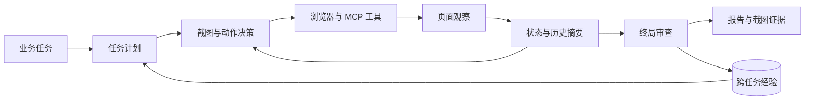

# Qwen3-VL GUI Agent

基于 Qwen3-VL-8B-Instruct 的截图驱动 Web GUI Agent。输入业务测试任务，模型通过鼠标和键盘操作真实应用，保存并重开业务记录，最后输出带截图证据的 `pass / fail / blocked` 判断。

项目已经贯通 **真实环境部署 → 数据采集 → LoRA SFT → GRPO → 评估 → Agent 运行**。当前重点是跑通完整流程，并保留每一步的可检查记录。



## 做了什么

- **真实 GUI 执行**：使用 Playwright 执行点击、输入、按键、滚动和等待；模型根据截图和动作反馈持续决策。
- **任务计划与状态**：拆分任务、维护步骤状态和下一步目标，逐步写入 `task-state.json`。
- **上下文与反思**：保留近期动作，将较早历史压缩为摘要；重复操作或工具错误触发反思并反馈到后续决策。
- **长期记忆**：使用 SQLite 保存操作经验，后续任务按任务文本、应用和流程检索。旧任务文本用于索引，模型接收程序经验及来源。
- **MCP 工具接入**：统一浏览器工具与外部 MCP 工具，支持工具发现、参数校验、调用和结果反馈；内置独立的 MCP 经验服务。
- **数据与训练**：从真实运行采集多模态操作和审查数据，完成多轮 LoRA SFT、GRPO 训练、权重导出和对照评估。
- **独立验证与报告**：独立判据核对本次提交和重开后的同一记录；保存原始模型输出、动作轨迹、截图及 JSON、Markdown、JUnit 报告。

操作与终局审查可以加载训练后的 GRPO adapter；计划、摘要和经验总结默认使用同一底座的原始 Instruct 权重，两种角色共用已加载的底座。

## 已验证结果

截至 2026-11-09，本地完整测试 **334 项通过**；发布前从待提交文件导出的干净副本通过 **86 项 CPU、浏览器与 MCP 测试**。最新数据包包含 800 条 SFT 训练样本，其中审查训练池为 655 条；新开发集 150 条，五个留出应用的最终测试集 150 条、100 个底层场景。

最新 GRPO 完成 100 次优化更新，采样 300 个问题组、覆盖 241 道不同问题，其中 40 组产生正误奖励差异。

| 同源截图审查指标 | 扩充 SFT | GRPO 后 |
| --- | ---: | ---: |
| 开发集原始终判正确 | 138/150 | 134/150 |
| 测试集原始终判正确 | 124/150 | 124/150 |
| 测试集事实与引用严格正确 | 66/150 | 67/150 |
| 测试集缺陷检出 | 39/49 | 40/49 |

这组结果对应给定截图和动作记录的审查评估。最新 GRPO 的测试集总正确数持平。

完整运行时另做了两项真实浏览器任务：

| 任务 | Agent 判定 | 独立判据 | 运行记录 |
| --- | --- | --- | --- |
| 编辑站点变量 | pass | pass | [编辑任务](examples/agent-runtime/edit/report.md) |
| 创建站点变量 | blocked | inconclusive | [创建任务](examples/agent-runtime/create/report.md) |

第二项任务实际读取了第一项保存的经验，完成了上下文更新和 MCP 交互，业务操作在确认保存前结束。公开示例保留原始输出和截图。

[结果与来源哈希](docs/results/summary.json) · [测试记录](docs/results/tests.xml) · [示例来源](examples/agent-runtime/provenance.json)

## 环境准备

已在 Ubuntu 24.04、Python 3.10、PHP 8.3、MariaDB 10.11 和 Chromium 上运行。应用、数据库和会话使用项目目录及用户进程；Anchor CMS 另使用项目内 PHP 7.4。

```bash
git clone git@github.com:amnika2/Qwen3-vl-gui-agent.git
cd Qwen3-vl-gui-agent
python -m venv .venv
.venv/bin/pip install -e '.[test,agent]'
.venv/bin/python -m playwright install chromium
.venv/bin/python -m guiqa prepare
.venv/bin/python scripts/fetch_sources.py
bash scripts/bootstrap_native.sh
.venv/bin/python scripts/bootstrap_php74.py
.venv/bin/python scripts/fetch_akaunting_fixtures.py
bash scripts/build_apps.sh
```

`prepare` 获取固定 revision 的 SWEeper-Bench；`fetch_sources.py` 获取应用源码并生成本地测试 fixture。应用版本和五个正式案例见 [案例说明](cases/README.md)。

准备模型环境与底座：

```bash
python -m venv .model-venv
.model-venv/bin/pip install -e '.[model,agent]'
.model-venv/bin/python scripts/download_model.py
```

## 运行完整 Agent

下载底座后可以直接运行带计划、记忆和 MCP 的配置：

```bash
CUDA_VISIBLE_DEVICES=2 LD_LIBRARY_PATH="$PWD/vendor/runtime/root/usr/lib/x86_64-linux-gnu" OMP_NUM_THREADS=4 \
  .model-venv/bin/python -m guiqa run \
  --case sweeper-008 --build B --workflow target --method qwen-controlled \
  --config configs/agent-full-base.yaml --port 13381
```

`CUDA_VISIBLE_DEVICES` 按实际分配的 GPU 设置。使用本项目训练的权重时，改用 `configs/agent-full-grpo.yaml`，并将 adapter 放在该配置指定的位置或修改 `adapter_path`。

每次任务创建新应用实例，退出后关闭本次服务。运行记录写入 `runs/<run_id>/`，长期经验默认保存在 `.runtime/agent-memory.sqlite3`。

| 配置 | 用途 |
| --- | --- |
| `configs/agent-full-base.yaml` | 底座 + 完整 Agent 运行时 |
| `configs/agent-full-grpo.yaml` | GRPO adapter + 完整 Agent 运行时 |
| `configs/agent-review-evidence-expanded-v1.yaml` | 扩充审查 SFT adapter |
| `configs/rl-review-grpo-expanded-v1.yaml` | 最新 GRPO 训练配方 |

[MCP 配置与上下文机制](docs/AGENT_RUNTIME.md) · [训练与实验流程](docs/REVIEW_TRAINING_WORKFLOW.md) · [历史开发记录](docs/PROJECT_HISTORY.md)

## 训练、评估与测试

SFT 实现位于 `src/guiqa/train_sft.py`，GRPO 实现位于 `src/guiqa/train_review_grpo_expanded.py`。数据采集和构建入口在 `scripts/`，训练与评估参数在 `configs/`。

- [SFT v4](docs/SFT_V4.md)：操作与证据审查监督、训练及检查点选择。
- [数据扩充](docs/REVIEW_DATA_EXPANSION_RUN.md)：跨应用训练、开发和最终测试数据。
- [Agent 运行说明](docs/AGENT_RUNTIME.md)：状态、摘要、经验和 MCP 工具。

运行不依赖训练数据或模型下载的 CPU/浏览器测试：

```bash
LD_LIBRARY_PATH="$PWD/vendor/runtime/root/usr/lib/x86_64-linux-gnu" \
  xargs .venv/bin/pytest -q < configs/ci-tests.txt
```

完整训练与数据核验测试使用本地的数据包、运行产物及 RL 依赖环境；完整测试记录见上文。GitHub Actions 执行 `configs/ci-tests.txt` 中的独立测试集合。

仓库保存代码、配置、文档、小型结果摘要和真实运行示例。模型权重、训练数据、虚拟环境、应用依赖、完整运行目录和本地账户 fixture 在本地准备。

## 数据与上游来源

- [SWEeper-Bench](https://huggingface.co/datasets/zlab-princeton/SWEeper-Bench)：真实应用任务，固定 revision 与 SHA256 见 [数据来源记录](docs/data-manifest.json)，保留其 CC-BY-4.0 署名。
- [Qwen3-VL-8B-Instruct](https://huggingface.co/Qwen/Qwen3-VL-8B-Instruct)：模型来源和文件哈希见 [模型记录](docs/model-manifest.json)。
- Playwright：浏览器执行；MCP Python SDK：工具连接。
- 各应用沿用其上游许可证；项目配置记录对应的源码提交。

公开结果可由本地原始产物重新导出：

```bash
.venv/bin/python scripts/export_project_summary.py
```
