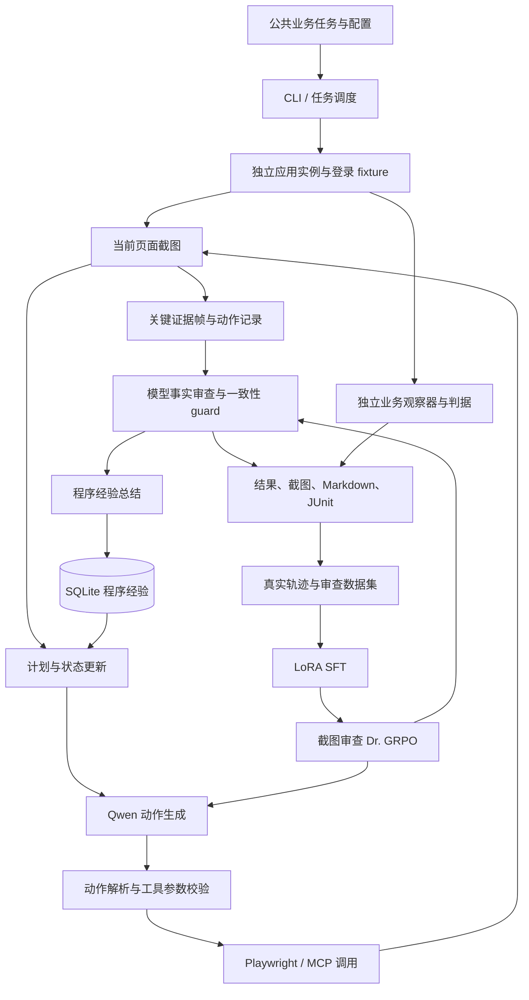

# Qwen3-VL GUI Agent 项目完整解读报告

编制日期：2026-11-10（Asia/Shanghai）

核对代码版本：`ef3cc31201a97c65125b800767a862dd70e7d0ec`

报告依据：本仓库源代码、配置、数据清单、训练完成记录、逐次运行结果，以及 2026-11-09 完成的端到端对照实验。

## 阅读导引

这个项目研究的是：**让视觉语言模型根据业务要求，在真实 Web 应用中完成输入、提交、重开与结果核验，并给出可追溯的业务回归结论。** 系统把浏览器操作、任务状态、证据审查、独立业务判据、数据采集和模型训练接成一个闭环。

当前最有代表性的两组结果是：

- 在给定截图和动作记录的 150 条跨应用测试审查中，扩充 SFT 与 GRPO 的原始终判均正确 `124/150`，即 `82.67%`；事实和引用严格正确分别为 `66/150`、`67/150`。
- 在实际执行鼠标键盘操作的五应用 A/B 对照中，Base、SFT、GRPO 完整运行时分别成功 `3/10`、`2/10`、`6/10`。GRPO 的六次成功包括五个修复版正常任务和一个缺陷版任务。

这两组结果分别描述**证据审查能力**和**完整任务执行能力**。后文围绕它们展开实现、训练和失败机制分析。训练和运行数据主要保存在本地 `datasets/`、`runs/`；可随源码阅读的小型结果位于 [docs/results](results/) 和 [reports](../reports/)。

| 章节 | 需要掌握的内容 | 本章回答的问题 |
| --- | --- | --- |
| [1. 项目背景与动机](#1-项目背景与动机) | 场景、痛点、目标、任务定义 | 为什么做，解决什么问题？ |
| [2. 整体技术架构](#2-整体技术架构) | 模块、数据流、输入输出 | 系统怎样完整工作？ |
| [3. 核心技术原理](#3-核心技术原理) | Qwen3-VL、动作闭环、LoRA、GRPO、MCP | 为什么选这些技术？ |
| [4. 核心模块实现](#4-核心模块实现) | 关键接口、状态结构、执行逻辑 | 代码具体怎样实现？ |
| [5. 数据集构建](#5-数据集构建) | 来源、采集、标注、清洗、划分 | 数据从哪里来，质量如何保证？ |
| [6. 模型训练与优化](#6-模型训练与优化) | 训练目标、损失、参数、资源优化 | 训练了什么，为什么这样训练？ |
| [7. 实验设计与评测](#7-实验设计与评测) | 基线、指标、配对、消融 | 怎样检验方案效果？ |
| [8. 实验结果分析](#8-实验结果分析) | 数值、失败案例、效率、结论 | 哪些方法有效，收益来自哪里？ |
| [9. 工程实现与排错](#9-工程实现与排错) | 部署、推理、显存、日志、诊断 | 怎样运行，遇到问题怎样定位？ |
| [10. 项目贡献与改进](#10-项目贡献与改进) | 已完成工作、技术亮点、局限、路线 | 核心贡献是什么，下一步做什么？ |

## 1. 项目背景与动机

### 1.1 应用场景：真实业务的 GUI 回归测试

典型任务是：“把某条站点变量的值修改为指定文本，保存后重新打开，确认修改是否持久化。”完成它需要连续建立四个事实：找到正确对象、输入正确内容、实际完成提交、在同一对象的结果页面读到最终值。

项目选用的五个核心评测应用覆盖以下业务：

| 案例 | 应用 | 主要业务任务 | 最终核验对象 |
| --- | --- | --- | --- |
| `sweeper-005` | Akaunting | 创建带本地化价格的商品 | 新商品 ID 及列表售价 |
| `sweeper-007` | Ampache | 修改智能播放列表名称 | 同一播放列表 ID 的重开标题 |
| `sweeper-008` | Anchor CMS | 修改自定义站点变量 | 同一变量键的持久化值 |
| `sweeper-040` | Easy!Appointments | 修改服务人员手机号 | 同一服务人员的保存后字段 |
| `sweeper-041` | emlog | 修改作者或管理员昵称 | 同一账户的重开昵称或提交响应 |

每个案例部署两个固定源码版本：A 对应缺陷版，B 对应参考修复版。`target` 流程触发目标问题，`preservation` 流程检查相邻业务能力。标准预期矩阵是：

| 版本 | target | preservation |
| --- | --- | --- |
| A：缺陷版 | 应检出 `fail` | 应为 `pass` |
| B：修复版 | 应为 `pass` | 应为 `pass` |

因此，“任务成功”包括正确识别缺陷后返回 `fail`。这里的成功指测试完成且结论正确。

依据：[案例说明](../cases/README.md)、[固定提交索引](../cases/index.csv)、[runner.py](../src/guiqa/runner.py) 中的 `matrix_expected`。

### 1.2 现有方法与项目要解决的痛点

手写 Playwright 脚本能稳定执行已知流程，但需要预先编写页面定位和业务断言。项目把它作为环境校准和确定性参考，证明应用确实可以通过界面复现问题。

截图驱动的视觉语言模型可以直接理解任务和页面，降低对专门定位脚本的依赖；实际执行却出现三类连续困难：

1. **动作困难**：点击没有聚焦到输入框，文本插入而未覆盖，反复刷新或重复点击。
2. **状态困难**：长流程中忘记已完成步骤，保存后仍重复输入，或者未重开对象就结束。
3. **判断困难**：把点击 Save 当成提交成功，把输入框的临时值当成保存结果，或者把另一个字段当成被测字段。

早期正式实验直观展示了这些困难：五应用、三方法、两版本、两流程、每条件两次，共 `120` 次运行中，原始 Qwen 和加入动作进度记录的 Qwen 都只取得 `0/10` 有效缺陷检出；固定脚本为 `10/10`。单独加入进度文本没有解决输入、提交和证据理解问题。

依据：[早期正式结果](../reports/summary.md)。

### 1.3 项目目标与研究问题

项目的目标分为四层：

- **可执行**：模型根据截图产生动作，并在真实应用中完成业务流程。
- **可判断**：终判依赖输入、提交、结果三个阶段的证据。
- **可学习**：真实轨迹可转成操作与审查监督，继续进行 SFT 和奖励训练。
- **可追溯**：结论能回到原始输出、截图、提交事件、应用版本和运行配置。

相应的研究问题是：监督训练能否改善操作和审查？结构化事实能否降低格式与证据错误？GRPO 能否进一步改善判断，并迁移到交互执行？计划、长期记忆和显式反思分别对端到端成功贡献多少？

### 1.4 输出结论的业务含义

| Agent 结论 | 含义 | 典型条件 |
| --- | --- | --- |
| `pass` | 本次观察到的结果满足任务要求 | 正确输入、有效提交、同一对象结果符合要求；或明确要求的无效输入被正确拒绝 |
| `fail` | 已建立证据，结果违反业务要求 | 正确输入和提交后值未持久化，或有效输入遭遇任务相关的错误拒绝 |
| `blocked` | 本次运行尚未建立足够的业务结论 | 输入未完成、提交状态不明、找不到最终对象、执行预算耗尽 |

独立判据另有 `inconclusive` 与 `infra_error` 等状态，用于说明业务证据不足或环境故障。报告同时保存 Agent 和独立判据的判断。

## 2. 整体技术架构

### 2.1 两条相互衔接的主链路

在线链路负责执行任务，离线链路负责把执行证据变成训练数据和评测结果：



图中的“独立业务观察器”向结果文件提供判据证据；模型决策使用公共任务、截图、动作和运行时上下文。两路信息在结果汇总阶段对照。

### 2.2 模块及职责

| 模块 | 核心文件 | 职责 | 主要输出 |
| --- | --- | --- | --- |
| CLI 与配置 | [cli.py](../src/guiqa/cli.py) | 命令分发、配置加载、就绪检查、模型选择 | 实际运行参数 |
| 单任务执行器 | [runner.py](../src/guiqa/runner.py) | 启动实例、执行循环、调用审查、独立评分、收尾 | 单次 `result.json` |
| 任务清单 | [tasks.py](../src/guiqa/tasks.py) | 顺序执行、模型复用、续跑与重试索引 | `session.json`、清单报告 |
| 多模态模型 | [model.py](../src/guiqa/model.py) | 动作、计划、摘要、审查和经验生成 | 原始模型输出及用量 |
| Agent 会话 | [agent_session.py](../src/guiqa/agent_session.py) | 计划、状态、历史压缩、反思、记忆生命周期 | `task-state.json` |
| 浏览器动作 | [actions.py](../src/guiqa/actions.py)、[browser.py](../src/guiqa/browser.py) | 动作入口校验、坐标转换、鼠标键盘执行 | 页面变化、动作反馈 |
| 工具与经验 | [agent_tools.py](../src/guiqa/agent_tools.py)、[agent_memory.py](../src/guiqa/agent_memory.py)、[mcp_server.py](../src/guiqa/mcp_server.py) | MCP 发现与调用、SQLite 经验存取 | 工具记录、经验条目 |
| 控制与证据 | [control.py](../src/guiqa/control.py)、[review_context.py](../src/guiqa/review_context.py)、[review_facts.py](../src/guiqa/review_facts.py)、[review_contract.py](../src/guiqa/review_contract.py) | 循环识别、审查上下文、事实协议和一致性检查 | 结构化读值与终判 |
| 应用适配器与判据 | `runner.py` 的 `ADAPTERS` 及各应用实现 | 部署、登录、对象追踪、提交和重开观察 | 独立 `oracle_verdict` |
| 数据与训练 | `scripts/collect_*`、`src/guiqa/sft_*`、`train_sft.py`、`train_review_grpo_expanded.py` | 采集、打包、校验、SFT、GRPO | 数据包与 adapter |
| 实验与报告 | [e2e_experiment.py](../src/guiqa/e2e_experiment.py)、[e2e_report.py](../src/guiqa/e2e_report.py) | 冻结协议、逐格调度、配对比较 | CSV、JSON、Markdown 汇总 |

### 2.3 输入如何变成最终报告

一次标准执行依次发生：

1. 读取 `cases/<case_id>/public.json` 的任务要求和私有 fixture；fixture 用于部署与登录。
2. 根据 `build=A/B` 创建独立应用实例、数据库和浏览器会话，完成登录，保存初始截图。
3. 创建 `AgentSession`，通过内置 MCP 经验服务召回相关程序经验，生成任务计划。
4. 模型读取当前截图、近期动作和状态，输出一个 JSON 动作。
5. 解析动作并执行，保存新截图、工具反馈和原始输出；达到更新周期或发生错误时更新摘要与反思。
6. 模型提出结束，或控制器预留审查步骤时，组织关键截图进行终局审查。
7. 解析字段事实、提交状态、结果和引用；不满足契约的一致性条件时，guard 将结论降为 `blocked`。
8. Agent 终局后，在剩余预算内提炼程序经验并通过 MCP 保存到 SQLite，随后关闭会话工具连接。
9. 独立判据根据本次实际业务事件给出最终结果；执行器分别保存两路判断，关闭本次应用并生成报告。

### 2.4 主要输入输出和文件关系

完整运行配置 [agent-full-grpo.yaml](../configs/agent-full-grpo.yaml) 指定模型路径、adapter、审查协议、预算、历史窗口和记忆服务。任务输入可以是单个 `run`，也可以是 [tasks-demo.yaml](../configs/tasks-demo.yaml) 中的命名任务清单。

```text
runs/<run_id>/
├── manifest.json          实际配置、模型版本、预算、运行环境
├── result.json            Agent / oracle 判断、终止原因、动作数、耗时
├── task-state.json        计划、步骤状态、摘要、反思、下一步目标
├── trace.jsonl            已执行动作、反馈与截图索引
├── model.jsonl            原始模型输出、解析错误、模型阶段
├── context-events.jsonl   上下文更新与被压缩的动作
├── tool-catalog.json      本次可用工具
├── tool-calls.jsonl        浏览器与 MCP 调用
├── experience.json        本次提炼并保存的程序经验
├── screenshots/           逐步骤截图
├── private/               提交观察、对象身份、oracle、服务日志
├── report.md              单次可读报告
└── junit.xml              自动化测试系统可读结果
```

任务清单额外保存 `tasks.yaml`、`session.json`、自己的 `memory.sqlite3` 和汇总 `report.md`。清单内任务共享程序经验，每个任务仍创建独立业务实例。

## 3. 核心技术原理

### 3.1 Qwen3-VL 怎样理解页面并生成动作

底座为 `Qwen/Qwen3-VL-8B-Instruct`，项目固定到 revision `0c351dd01ed87e9c1b53cbc748cba10e6187ff3b`。推理流程可以概括为：

```text
页面截图 → 视觉编码与特征融合 → 多模态 token
业务任务 + 动作历史 + 状态文本 → 文本 token
多模态上下文 → 自回归解码 → 下一动作或审查 JSON
```

官方模型说明列出多层视觉特征融合 DeepStack 和空间/时间位置编码 Interleaved-MRoPE。对本项目而言，直接相关的是小字号字段读取、控件空间定位和图文对应；具体业务决策由任务提示、动作上下文和后续训练共同塑造。[Qwen3-VL 官方模型说明](https://huggingface.co/Qwen/Qwen3-VL-8B-Instruct)

采用这个底座的实际理由是：它能同时接收图像和文本，具备 GUI 与视觉定位能力，可以在本地加载，支持 PEFT adapter，且项目已有单卡 BF16 推理和训练链路。页面内容读取由视觉语言模型完成；当前链路没有单独接入 OCR 引擎。

### 3.2 截图动作闭环与部分可观测性

模型每次只看到截图和有限上下文，后台状态、保存结果和对象身份需要通过后续观察逐步确认。可以用部分可观测决策过程理解：

$$
a_t \sim \pi_\theta(a\mid I_t,\tau,h_t,c_t,m),
\qquad s_{t+1}=F(s_t,a_t).
$$

其中，`I_t` 是截图，`τ` 是公共任务，`h_t` 是近期动作，`c_t` 是计划和摘要，`m` 是检索经验；真实应用状态 `s_t` 通过页面表现为观察。

这解释了系统为什么强调“保存后重开同一记录”：输入框中的文字只能证明临时编辑状态；提交响应证明业务请求被处理；重开页面才提供持久化结果。三个阶段承担不同的证明功能。

### 3.3 为什么使用受约束的 JSON 动作

模型输出的动作空间包括：

```jsonl
{"action":"click","coordinate":[500,400]}
{"action":"type","text":"Hello"}
{"action":"press","key":"Control+a"}
{"action":"scroll","pixels":500}
{"action":"wait","seconds":1}
{"action":"finish","verdict":"pass","observation":"...","evidence_steps":[7]}
```

统一协议使语言生成能直接交给执行器。`parse_action()` 在模型输出进入系统时检查动作、参数范围和截图引用；执行器接收解析后的动作。完整运行时还支持调用工具注册表中的 MCP 工具。

JSON Schema 和 `lm-format-enforcer` 用于计划、事实审查等结构化生成，约束字段、枚举和现有截图步号。格式约束能减少无法解析的输出；字段读值和业务判断仍需要模型从截图中正确建立。

### 3.4 归一化坐标与实际点击

模型坐标范围是 `[0,1000]`。浏览器视口固定为 `1280×900`，DPR 为 `1`；[browser.py](../src/guiqa/browser.py) 的 `to_css()` 使用：

$$
x_{css}=\frac{x_n}{1000}(W-1),\qquad
y_{css}=\frac{y_n}{1000}(H-1).
$$

例如 `[500,500]` 映射到约 `(639.5,449.5)`。归一化协议统一了模型输出尺度，固定视口保证截图布局和鼠标操作空间对应。

`type` 的语义是向已聚焦控件插入文本。替换字段必须依次点击、`Control+a`、输入。这个约束直接来自实际出现过的追加旧文本错误。

### 3.5 LoRA：训练任务能力的低秩增量

LoRA 冻结底座权重，用两个低秩矩阵表示更新：

$$
W'=W+\frac{\alpha}{r}BA,
\qquad A\in\mathbb{R}^{r\times d_{in}},\ B\in\mathbb{R}^{d_{out}\times r}.
$$

当 `r` 远小于矩阵维度时，只训练 `A/B` 可以显著减少梯度与优化器状态。本项目把 LoRA 加到语言模型的注意力投影和 MLP 投影，视觉参数保持冻结，最新 SFT 可训练参数为 `43,646,976`。[LoRA 原论文](https://arxiv.org/abs/2106.09685)

其用途是学习两类输出：看到页面后采取什么操作，以及面对多阶段证据时怎样输出字段事实和业务结论。

### 3.6 GRPO：利用同题多个回答的相对优劣

GRPO 对同一问题生成多条候选，通过组内奖励形成优势，优化高奖励回答相对于低奖励回答的概率，省去额外训练价值网络的过程。[DeepSeekMath 原论文](https://arxiv.org/abs/2402.03300)

项目最新训练对象是**固定截图与动作记录上的结构化终局审查**。每题生成 `G=4` 个事实回答，比较字段读值、阶段引用、提交状态和终判是否正确，再更新审查 adapter。

本项目使用 `Dr. GRPO`，关闭奖励标准差归一化，优势可写为：

$$
A_i=r_i-\frac{1}{G}\sum_{j=1}^{G}r_j.
$$

训练目标保留概率比裁剪与参考策略 KL 约束，token 损失按固定最大生成长度归一化。固定长度归一化对应 `loss_type="dr_grpo"`，`scale_rewards=False` 对应不除组内标准差；实际实现锁定 TRL `0.27.2`。[TRL 官方算法说明](https://huggingface.co/docs/trl/grpo_trainer)

### 3.7 计划、摘要、反思与记忆怎样配合

- **计划**：把任务拆成若干具体子任务，记录 `pending / in_progress / done` 和下一步目标。
- **摘要**：近期保留四条动作，较早动作压缩进 summary，降低重复传入长历史的成本。
- **反思**：遇到重复动作、输入无可见变化、执行超时或工具错误，把观察到的问题转成下一步纠正信息。
- **长期记忆**：保存“如何定位、替换、保存、重开”的程序经验，后续按任务和应用相关性检索。

完整配置中，动作与审查使用选定 adapter，计划、摘要和经验总结使用同一底座的原始 Instruct 能力。`disable_adapter()` 在相应调用中临时停用 adapter，实现角色切换和底座复用。

SQLite 记忆存储的是文本经验，当前检索采用任务文本匹配及应用/流程信息加权；MCP 将它暴露为可发现、可调用的工具。模型不因读取上一任务的经验而自动获得上一任务的业务结论。

## 4. 核心模块实现

### 4.1 主入口：`run_case()` 与案例适配器

[runner.py](../src/guiqa/runner.py) 的核心接口是：

```python
run_case(root, case_id, build, workflow, method, config,
         port=13200, model=None, repeat=0, experiment="pilot",
         scenario=None, on_started=None)
```

`case_id` 选择应用适配器，`build` 决定部署版本，`workflow` 选择公共业务任务，`method` 选择参考脚本、采集或模型执行方式。`scenario` 用于采集时注入场景任务和 fixture。

每个适配器组合应用实例、登录方法、观察器、参考动作和 oracle。`run_case()` 负责统一生命周期，因此新增应用主要围绕部署、页面准备、业务观察和判据扩展。

运行先保存初始 `result.json`，过程中持续落盘，最终在 `finally` 关闭实例、写入观察器证据并生成报告。失败运行拥有自己的目录，重跑创建新的 ID。

### 4.2 执行循环：一次生成、一次动作、一次观察

[runner.py](../src/guiqa/runner.py) 的 `agent_loop()` 主要逻辑可概括为以下伪代码：

```python
while still_has_time:
    raw = model.generate(task, screenshot, history, state)
    action = parse_action(raw, existing_screenshot_steps, tools)
    if action_requests_tool:
        session.call_tool(action)
    elif action_requests_finish:
        if session.defer_finish(action):
            continue
        controlled_review(...)
        return
    else:
        execute(action)
        capture_screenshot_and_feedback()
        update_progress_and_loop_control()
        session.after_action(execution_error)
        reflect_if_needed()
        review_when_reserved_step_is_reached()
```

动作解析失败后有一次带错误反馈的重试；连续两次失败以 `invalid_output_twice` 结束。模型可继续看到解析错误说明。工具调用预算和浏览器动作预算分别管理。

完整运行时识别到动作循环后，更新反思并清空该轮循环统计，让模型尝试纠正。历史冻结控制器没有 `AgentSession` 时，会更早转入受控审查。这是不同实验阶段的控制策略差异。

### 4.3 动作解析与浏览器执行的边界

`parse_action()` 支持标准 JSON，也兼容单个 `computer_use` 包装和 `left_click` 名称。主要约束包括：坐标两个数且位于 `[0,1000]`；输入文本最多 2000 字符；滚动在 `[-1800,1800]`；等待在 `[0,5]` 秒；按键来自明确集合；结束引用必须指向本次已有截图。

`browser.execute()` 将动作映射到 Playwright 的 `mouse.click()`、`keyboard.insert_text()`、`keyboard.press()`、`mouse.wheel()` 等接口。这里的模型页面操作由坐标、鼠标和键盘完成；部署、登录 fixture、数据采集观察和独立 oracle 则使用专门的应用适配逻辑。

Playwright 提供实际浏览器输入、等待和页面操作能力；本项目在其上封装适合视觉模型的薄动作接口。[Playwright 官方输入文档](https://playwright.dev/python/docs/input)

### 4.4 `AgentSession` 的状态数据结构

实际会话类位于 [agent_session.py](../src/guiqa/agent_session.py)。状态的教学示例如下，字段对应实际实现：

```json
{
  "phase": "executing",
  "step": 5,
  "plan": [
    {"step": "填写变量名称", "status": "done"},
    {"step": "填写变量值", "status": "done"},
    {"step": "保存并重开记录", "status": "in_progress"}
  ],
  "summary": "已经填写名称和值，下一步保存。",
  "reflection": "",
  "next_goal": "点击保存按钮并检查提交响应",
  "compacted_through_step": 1,
  "retrieved_experiences": [],
  "context_updates": 2,
  "external_tool_calls": 0,
  "finish_deferrals": 0,
  "planner_adapter": "base"
}
```

关键方法的关系是：

| 方法 | 执行时机与作用 |
| --- | --- |
| `start()` | 检索经验并生成初始计划 |
| `refresh(reason)` | 压缩移出窗口的动作，更新状态、摘要和下一步目标 |
| `after_action(error)` | 保存状态，按错误或动作周期触发上下文更新 |
| `reflect(reason)` | 在启用显式反思时进行事件驱动更新 |
| `defer_finish(action)` | 结束前核对未完成计划，必要时推迟一次结束 |
| `call_tool(action)` | 调用 MCP 工具，将结果反馈到模型状态 |
| `finish()` | 整理终态，在预算内提炼并保存程序经验 |

初始计划要求具体 GUI 子任务；后续更新固定计划条目，只更新等长状态数组，从而保持步骤身份连续。默认每三个浏览器动作更新一次上下文。

### 4.5 结构化事实审查的接口

最新 `evidence_facts_v1` 让模型生成读值和结论，由 `render_facts()` 从字段生成说明。以下为说明协议的人工示例：

```json
{
  "action": "finish",
  "task_kind": "edit",
  "field_readings": [{
    "field": "Greeting",
    "intent": "edit",
    "requested_value": "Welcome back",
    "before": {"value": "Welcome back", "step": 3},
    "after": {"value": "Hello Anchor", "step": 7},
    "input_matches_request": true,
    "result_matches_request": false
  }],
  "submission": {"status": "accepted", "evidence": {"step": 4}},
  "result_observed": true,
  "result_steps": [7],
  "expected_rejection": false,
  "verdict": "fail",
  "evidence_steps": [3, 4, 7]
}
```

`before` 对编辑字段表示提交前实际输入，对保留字段表示初始基准；`after` 表示提交并重开后的读值。看不清或未建立证据时使用 `null`，可见空字符串使用 `""`。

`parse_facts()` 调用 `render_facts()` 后复用 `parse_review()`；`review_guard()` 检查任务、比较关系、提交状态和终判是否一致。模型仍负责读值与生成 verdict；程序根据模型事实生成说明并检查契约。

这种拆分把失败定位到更细的层面：字段读错、阶段引用错误、提交状态误判、事实与终判矛盾。准确率之外的严格指标因此能够检查结论依据。

### 4.6 独立判据怎样核验真实业务

各应用观察器记录真实提交事件、对象 ID、响应、重开页面和最终值。判据依次确认：

1. 本次任务有没有对目标对象提交正确输入；
2. 页面或响应是否证明提交被处理；
3. 后续读取是否对应同一对象；
4. 最终值或特定业务拒绝是否满足任务预期。

例如，未保存时重开页面看到旧值，只说明编辑尚未持久化，尚不能归因为产品缺陷；已正确提交并重开同一记录仍看到旧值，才建立持久化失败证据。

观察器还要正确识别实际应用路由：Ampache 的列表读取既可能通过 GET，也可能通过 POST 和 AJAX/hash 路由。项目因此为不同应用实现特定观察器，而在上层统一结果格式。

### 4.7 工具发现与程序经验

[agent_tools.py](../src/guiqa/agent_tools.py) 中，`MCPConnections` 管理服务连接，`ToolRegistry` 将浏览器动作和外部 MCP 工具组织为统一目录。内置经验服务通过 `python -m guiqa.mcp_server` 启动，提供经验搜索和保存。

`ExperienceStore` 将任务索引、应用、流程、来源 run ID、`procedure` 和 `lessons` 写入 SQLite。经验生成只提炼控件操作、替换输入、保存和重开方法；具体任务值、凭据和版本结论不进入程序经验正文。

日常任务清单允许后续任务读取前序经验。正式 E2E 实验为每个任务复制同一冻结经验库，使对照组拥有一致的起始经验，避免评测执行顺序改变后续任务输入。

### 4.8 续跑的准确语义

[tasks.py](../src/guiqa/tasks.py) 记录任务及历次尝试。`tasks --resume` 跳过已有完整结果的任务，对中断项和未启动项继续调度；`--retry-failed` 创建新的失败任务尝试。

中断项从新的应用实例重做，原截图和动作保留在旧 run 目录。模型在同一 worker 内可复用，应用和数据库按任务重置。这个设计使“保留实验历史”和“获得干净执行环境”同时成立。

## 5. 数据集构建

### 5.1 数据来源：官方任务、真实应用和项目扩展场景

上游任务来自 SWEeper-Bench，固定 revision 为 `f10cd684be52322667f1373c8295624e13791b8f`，原始文件包含 200 条记录。来源、SHA256 与 CC-BY-4.0 署名保存在 [data-manifest.json](data-manifest.json)。应用源码使用任务对应的固定 base/reference 提交。

原始任务提供业务要求、缺陷及修复版本线索；训练使用的截图、动作和多阶段审查样本由项目运行真实应用采集。采集场景进一步变化输入值、字段组合、初始状态和执行阶段，形成成功保存、产品失败、未提交和证据不足等情况。

主训练集中于十个表单类应用：

| 来源类型 | 应用 | 训练能力示例 |
| --- | --- | --- |
| 官方表单流程 | PluXml、Typesetter | 密码或显示名修改、主题文本保存 |
| 官方表单流程 | LiteCart、Wolf CMS | 区域字段和国家选择、页面标题和重复 slug 校验 |
| 官方表单流程 | ImpressCMS、OpenCart | 设置修改、商品 option 的小数重量和库存 |
| 官方表单流程 | MantisBT、phpIPAM | 多字段创建、清空描述和修改主机名 |
| 项目补充流程 | DokuWiki、FlatPress | 正文编辑、保存、重开和保留字段 |

DokuWiki 与 FlatPress 的上述流程是项目自建文本编辑任务；其原官方任务分别涉及 ACL 与 PrettyURLs。WonderCMS 的 48 条菜单排序数据保留为辅助数据，单列于十应用主训练之外。

五个 GUI 评测应用作为训练的应用级留出。分区依据：[sft-split.yaml](../configs/sft-split.yaml)、[十应用选择说明](sft-training-selection.md)。

### 5.2 从一条轨迹生成什么监督

一条完整轨迹可以导出多条操作样本和一条审查样本：

```text
真实任务轨迹
  截图0 + 公共任务                 → 第1个动作
  截图1 + 公共任务 + 近期动作      → 第2个动作
  ……
  最终操作状态                    → finish 动作
  关键输入/提交/重开截图 + 动作     → 结构化事实审查
```

操作样本训练下一步决策；finish 样本训练何时结束；审查样本训练读值、阶段区分、证据引用和终判。

初版统一数据包 `datasets/sft-main-10apps-v1` 包含 `102` 条完整轨迹、`1398` 条样本，其中操作 `1296` 条、审查 `102` 条，划分为 train `1164`、validation `234`，共有 `919` 张按内容去重的图片。构建前的 `112` 条有效来源轨迹按任务、结局和语义动作序列去掉 `10` 条重复轨迹。

来源批次由 [sft-release.yaml](../configs/sft-release.yaml) 的白名单固定，构建器按来源清单打包。详细统计见 [SFT_DATA_STATUS.md](SFT_DATA_STATUS.md)。

### 5.3 最新扩充数据的规模与分布

最新扩采执行 `820` 条真实轨迹，保留 `810` 条新增审查，另完成 `40` 条独立校准。Wolf 重复 slug 场景的十条等价版本轨迹保留原始记录，去掉重复计数。

| 分区 | 审查样本 | pass | fail | blocked | 父场景 |
| --- | ---: | ---: | ---: | ---: | ---: |
| 训练：原 145＋新增 510 | 655 | 315 | 213 | 127 | 347 |
| 新开发集 | 150 | 50 | 50 | 50 | 65 |
| 原开发集，单列保留 | 39 | 18 | 9 | 12 | 25 |
| 五应用最终测试集 | 150 | 74 | 49 | 27 | 100 |

SFT 的最终训练文件还加入 `145` 条原操作回放，因此是 **655 条审查＋145 条操作＝800 条训练样本**。新开发集覆盖七个训练应用；最终测试集覆盖五个留出应用，每个应用 30 条。

主要成品为：

| 路径 | 内容 |
| --- | --- |
| `datasets/sft-review-expanded-v1/train.jsonl` | 800 条 SFT 样本 |
| `datasets/sft-review-expanded-v1/validation.jsonl` | 150 条新开发审查 |
| `datasets/sft-review-expanded-v1/legacy-validation.jsonl` | 39 条历史开发审查 |
| `datasets/rl-review-expanded-v1/train.jsonl` | 655 条 RL 审查池 |
| `datasets/rl-review-expanded-v1/validation.jsonl` | 150 条开发审查 |
| `datasets/review-final-test-expanded-v1/test.jsonl` | 150 条最终测试审查 |

SFT 数据包有 `1819` 张去重图片，最终测试包有 `463` 张。事实协议文件同时保留对应的 `evidence_v2` 版本，以追溯完整原始标注。

依据：[扩采完成记录](REVIEW_DATA_EXPANSION_RUN.md)、[SFT 成品清单](../datasets/sft-review-expanded-v1/manifest.json)、[测试成品清单](../datasets/review-final-test-expanded-v1/manifest.json)。

### 5.4 实际采集与标注流程

[expanded_training_collection.py](../src/guiqa/expanded_training_collection.py) 的 `collect_one()` 执行以下流程：

1. 从场景配置生成公共任务、初始业务记录和请求值。
2. 启动固定 A/B 版本，创建本次 fixture，完成真实浏览器登录。
3. 执行应用专用的确定性操作流，并逐步保存截图和动作。
4. 观察同次运行的可见字段、提交响应和重开结果。
5. 运行独立 oracle，生成本次提交与业务结局的证据。
6. 将可见读值与阶段信息组织为审查标签，执行协议解析和一致性检查。
7. 核对可成立的 `pass/fail` 与本次 oracle，保存标签及 provenance。

最新新增数据采用“同次运行可见字段＋独立判据”的程序化采集。打包记录的 `teacher_model_calls=0`；人工/视觉复核覆盖随版本分别记录。历史 v3 的 124 条审查做过逐图核对，v5 新增 40 条审查的 68 张去重关键图也有核图记录。

最终测试中，两条轨迹虽然执行了保存，但关键截图缺少明确提交响应，因此按可见证据标为 `blocked`。这表明标签依据本次证据，而不是机械地把 A 映射为 fail、B 映射为 pass。

### 5.5 清洗与质量控制如何落到代码

[review_expansion.py](../src/guiqa/review_expansion.py) 的 `load_batch()` 核验来源批次、文件哈希、运行完成状态、固定提交、截图步号、原图字节、动作轨迹和标签绑定。质量检查可以分成三层：

| 层次 | 检查内容 | 对应要解决的问题 |
| --- | --- | --- |
| 来源一致性 | case、commit、source run、trace 与图片 SHA256 | 保证样本来自明确的真实运行 |
| 证据一致性 | 截图 step 存在、字段读值有可见来源、阶段与对象对应 | 保证标签描述本次图像与操作 |
| 任务一致性 | 公共要求、字段意图、提交状态、终判通过契约，结局与 oracle 对照 | 保证业务标签有足够依据 |

图片按内容哈希去重；完整轨迹按语义键去重；被替代、失败和调试运行保留在原目录，成品通过来源白名单选择。

18 条 DokuWiki/FlatPress 派生任务补充公开初始基准，使“追加、后缀替换、保留内容”有可比较的任务文本。原任务、派生任务、图片与转换源码哈希同时保留。

输入预检还验证多图 collator 和生成预算：事实协议共 `994` 条审查可解析，训练答案最长 `551` tokens，新开发最长 `545`，测试最长 `260`，均位于当前 `1024` token 的审查预算内。

### 5.6 数据怎样划分，怎样避免同场景穿越

划分单位以场景和任务内容为核心，而不是随机打散单步样本。`validate_partitions()` 检查以下键在训练、新开发、原开发和最终测试之间的交叉：

- 公开任务内容键；
- 规范化字段需求键；
- 父场景；
- 来源运行。

同一父场景派生的 A/B 版本和阶段变体保留在同一分区。五个评测应用与十个训练应用另做应用级隔离。

统计时，150 条最终测试审查对应 100 个父场景；同一场景的相关变体应作为相关观察理解。后续评估泛化能力时，新增独立场景和新应用比重复同一场景产生更多行更有信息量。

依据：[成品核验](../datasets/sft-review-expanded-v1/verification.json)、[测试核验](../datasets/review-final-test-expanded-v1/verification.json)、[review_expansion.py](../src/guiqa/review_expansion.py)。

## 6. 模型训练与优化

### 6.1 训练目标与角色分工

项目主要训练两类能力：

| 训练任务 | 输入 | 目标输出 | 要改善的行为 |
| --- | --- | --- | --- |
| 操作 SFT | 当前截图、任务、动作历史 | 下一动作或结束 JSON | 定位、输入、保存、重开、及时结束 |
| 审查 SFT | 关键截图、任务、动作记录 | 字段事实、引用、提交状态、终判 | 正确读值、建立阶段证据、区分 blocked 与产品失败 |
| 审查 GRPO | 同样的固定审查输入 | 同题四个候选事实回答 | 提高严格事实与结论一致的回答概率 |

当前 planner、摘要和经验总结使用原始 Base；这几个角色通过提示和运行时管理工作。Actor 与 Reviewer 共用选定 adapter，所以审查训练产生的权重变化也会影响实际操作输出。

### 6.2 SFT 数据整理与 assistant-only 损失

训练入口为 [train_sft.py](../src/guiqa/train_sft.py)，batch 构造为 [sft_collator.py](../src/guiqa/sft_collator.py) 的 `QwenSftCollator`。

collator 使用同一 chat template 渲染完整消息和答案前缀，按顺序加载多张原图。`labels` 初始全部为 `-100`，只对最后一条 assistant 答案和 EOS 计算交叉熵：

$$
\mathcal L_{SFT}=-\frac{1}{|\mathcal A|}
\sum_{t\in\mathcal A}\log p_\theta(y_t\mid x,y_{<t}).
$$

`x` 是任务、截图与上下文，`𝒜` 是答案 token 集合。提示、历史和图像 token 提供条件信息。

这里有一个实现细节：chat template 中每张图初始只有一个占位符，processor 会把它展开成多个视觉 token。代码用 `visual_tokens - image_count` 修正答案起点，确保训练标签仍对齐到 assistant JSON。

`AssistantTrainer.compute_loss()` 通过 `logits_to_keep` 只计算答案区间附近需要的词表 logits，保留首个答案 token 的因果预测位置，减少长多图提示产生的词表张量开销。

### 6.3 SFT 版本演进：每次修改针对什么问题

| 版本 | 数据规模 | 主要变化 | 训练概况 |
| --- | --- | --- | --- |
| v1 | 1398；train1164/dev234 | 基础操作与简单审查 | 1 轮、73 步 |
| v2 | 1636；1350/286 | 增加操作结束、真实未提交审查、字段对照与四图证据 | 2 轮、170 步 |
| v3 | 1636；1350/286 | 1512 条操作/结束样本复用，124 条审查逐图核对并改为 `evidence_v1` | 2 轮、170 步 |
| v4 | 1642；1354/288 | `evidence_v2`，区分字段意图、读值、提交，五图组织，补 Copy/Cancel | 2 轮、170 步 |
| 审查 v5 | train290＝145审查＋145操作；dev39 | `evidence_facts_v1`，由程序生成说明 | 从 v4 继续，2 轮、38 步 |
| expanded-v1 | train800＝655审查＋145操作；dev150 | 扩大多应用与 blocked/失败场景覆盖 | 从 v4 继续，2 轮、100 步 |

v4 在训练应用的 25 条审查验证题上选择检查点，优先正确审查数量，再比较错误放行和验证 loss，最终选择第二轮。最新 expanded SFT 从该 v4 adapter 初始化，固定训练两轮后导出第二轮。

依据：[v2](SFT_V2.md)、[v3](SFT_V3.md)、[v4](SFT_V4.md)、[审查 v5](SFT_REVIEW_V5.md)、[expanded 完成记录](../runs/sft-qwen3vl-review-expanded-v1/completion.json)。

### 6.4 最新 SFT 的超参数与完成结果

| 参数 | 实际设置 |
| --- | --- |
| 底座 | 固定 revision 的 Qwen3-VL-8B-Instruct |
| 初始化 adapter | `runs/sft-qwen3vl-10apps-v4-review-selected/adapter` |
| LoRA rank / alpha / dropout | `16 / 32 / 0.05`，继承初始化 adapter |
| LoRA 位置 | 语言层 `q/k/v/o_proj` 与 `gate/up/down_proj` |
| 训练 / 开发样本 | `800 / 150` |
| 图像 min/max pixels | `200704 / 802816` |
| epochs | `2` |
| 学习率 | `2e-5` |
| 优化器 / 调度器 | AdamW / cosine |
| 每卡 batch / 梯度累积 / 卡数 | `1 / 8 / 2` |
| 有效 batch | `16` |
| warmup ratio / weight decay | `0.03 / 0.01` |
| 精度与内存 | BF16、SDPA、gradient checkpointing、激活 CPU 暂存 |
| seed | `42` |
| checkpoint 与评估 | 每轮保存、每轮评估，固定导出最后一轮 |

实际完成 `100` 次优化更新，训练时间 `2825.29` 秒，约 `47.1` 分钟；训练 loss 为 `0.0206268`，开发 loss 为 `0.00343823`。最终可训练参数 `43,646,976`，视觉可训练参数 `0`，初始 v4 权重文件字节保持。

低 token loss 说明金标输出分布容易被拟合；任务效果仍需自由生成后的终判、事实、引用和端到端指标衡量。第 8 章会展示低 loss 与跨应用严格准确率之间的差距。

配置与结果：[sft-train-review-expanded-v1.yaml](../configs/sft-train-review-expanded-v1.yaml)、[completion.json](../runs/sft-qwen3vl-review-expanded-v1/completion.json)。

### 6.5 最新 GRPO 的奖励怎样定义

训练入口为 [train_review_grpo_expanded.py](../src/guiqa/train_review_grpo_expanded.py)，奖励为 [rl_review_expanded_reward.py](../src/guiqa/rl_review_expanded_reward.py) 的 `ExpandedFactsReward`。

评分同时检查原始事实与结论：

| 候选回答状态 | 源奖励 |
| --- | ---: |
| 事实、引用、阶段与终判严格正确 | `+1` |
| 已确认存在读值、引用、阶段或终判错误 | `-1` |
| 仍无法可信核验，或截断等 | `None` |

引用评分允许同次运行中真正等价的截图：同页面、同字段、相同字面值、已选截图及正确阶段。提交证据的引用规则单独保持。

扩充版对未知回答采用以下实际代码：

```python
def group_task_rewards(values):
    known = [value for value in values if value is not None]
    mean = sum(known) / len(known) if known else 0.0
    return [mean if value is None else value for value in values]
```

例如 `[+1,-1,None,+1]` 中未知项得到 `1/3`，组均值也是 `1/3`，所以未知项的任务优势为零。全未知组补零。同奖组、未知组仍按固定排程记录并交给训练器。

早期 grouped-v5 只选全可评分且正负并存的有效 G4；最新扩充版采用上述固定排程和未知均值填充。两种实验的采样规则应分别理解。

### 6.6 GRPO 损失与参考策略

对同题候选 `o_i`，以生成时策略作为旧策略，token 概率比为：

$$
\rho_{i,t}(\theta)=
\frac{\pi_\theta(o_{i,t}\mid q,o_{i,<t})}
{\pi_{old}(o_{i,t}\mid q,o_{i,<t})}.
$$

项目优化可概括为：

$$
\mathcal L=-\frac{1}{G L_{max}}
\sum_i\sum_t\left[
\min\big(\rho_{i,t}A_i,
\operatorname{clip}(\rho_{i,t},1-\epsilon,1+\epsilon)A_i\big)
-\beta\widehat D_{KL,i,t}\right].
$$

裁剪项限制单次更新偏移；KL 项把策略约束在初始 SFT 参考附近；`Lmax` 对应固定最大 completion 长度。实际概率、mask、KL 估计和梯度由锁定版本的 TRL 父类计算，项目封装多模态生成、参考 adapter、奖励和审计记录。

参考策略采用冻结的独立参考 adapter，底座复用。完成记录核验 actor 已变化，reference 哈希保持，且参考初始化等于训练前的 SFT adapter。

### 6.7 最新 GRPO 超参数与有效训练信号

| 参数 | 实际设置 |
| --- | --- |
| 初始化 | 扩充 SFT adapter |
| 训练框架 | TRL `0.27.2` |
| 问题池 | `655` 道审查题 |
| 每次更新的问题 | pass、fail、blocked 各一道，轮换应用 |
| 每题候选数 | `4` |
| 每次更新候选 / 梯度累积 | `12 / 12` |
| 优化更新上限 | `100` |
| 学习率 / beta | `2e-6 / 0.02` |
| loss / 奖励缩放 | `dr_grpo / scale_rewards=False` |
| 调度器 / weight decay | constant / `0` |
| 最大生成 / temperature | `1024 tokens / 0.8` |
| top-p / top-k | `1 / 0` |
| 采样实现 | Transformers 原生随机生成，逐候选收集完整 G4 |
| checkpoint | 每 `20` 步保存 |
| seed | `42` |

训练采样使用随机生成探索不同答案；正式评估使用 greedy，保证同输入对照设置一致。

实际完成情况：

| 项目 | 数值 |
| --- | ---: |
| 优化更新 | 100 |
| 题目曝光 / G4 组 | 300 |
| 不同问题 | 241 |
| 总候选 | 1200 |
| 正奖 / 负奖 / 未知候选 | 711 / 390 / 99 |
| 正误有差异的组 | 40/300 |
| 已知同奖组 / 全未知组 | 254 / 6 |
| 含至少一个差异组的更新 | 34/100 |
| 总耗时 | 30493.32 秒，约 8.47 小时 |
| 峰值 allocated 显存 | 20627.64 MiB，约 20.14 GiB |

`100` 次更新中，只有 `34` 次包含可区分正误的任务奖励组。这解释了训练规模与有效学习信号之间的差距。同奖组的任务优势为零，训练中还存在 KL 和优化器状态的作用。

配置：[rl-review-grpo-expanded-v1.yaml](../configs/rl-review-grpo-expanded-v1.yaml)；完成与逐组记录：[completion.json](../runs/rl-review-grpo-expanded-v1/completion.json)、[reward-groups.jsonl](../runs/rl-review-grpo-expanded-v1/reward-groups.jsonl)、[update-steps.jsonl](../runs/rl-review-grpo-expanded-v1/update-steps.jsonl)。

### 6.8 显存优化与恢复

SFT 与 GRPO 共同使用冻结底座、语言层 LoRA、BF16、SDPA、gradient checkpointing；通过 `save_on_cpu(pin_memory=True)` 将反向传播所需激活暂存 CPU。

GRPO 曾在 24 GiB 卡上同时生成 G4 时出现 OOM，现改为逐候选生成，收集四答后维持同题组内奖励和训练语义。SFT 则通过答案区间 logits 减少大词表张量。

SFT `--resume-from` 恢复训练 checkpoint 的优化器、调度器和 RNG；GRPO 恢复前还核对原始数据、排程、源码及初始化哈希。`init_adapter_path` 表示初始化来源，`--resume-from` 表示继续原训练状态。

## 7. 实验设计与评测

### 7.1 三类实验分别回答什么问题

| 层次 | 执行方式 | 规模 | 核心问题 |
| --- | --- | ---: | --- |
| 初始 GUI 对照 | script、原始 Qwen、进度文本 Qwen 操作真实应用 | 120 次 | 模型能否触发并检出缺陷，进度文本是否有效？ |
| 固定截图审查 | 给定真实关键截图和动作记录，模型生成审查 | 最终测试 150 条、100 场景 | 已有证据时，模型是否能准确读值、引用和判断？ |
| 完整 Agent 对照与消融 | 六组在五应用 A/B target 实际操作 | 60 次，各组 10 次 | 权重与运行时机制如何影响任务完成？ |

历史实验的提示、控制器、证据协议和样本发生过变化；同表比较优先使用同一批输入、同一协议的配对结果。

### 7.2 初始 120 次正式对照

设计为：

$$
5\text{应用}\times2\text{版本}\times2\text{流程}
\times2\text{重复}\times3\text{方法}=120.
$$

`script` 使用预编写定位和业务逻辑，是环境可复现性与能力参考。`qwen-base` 与 `qwen-improved` 使用相同任务、截图、预算和底座；后者增加动作进度文本。每次最多 30 个浏览器动作、600 秒。

重复两次用于观察执行波动；五个应用仍是五个应用。脚本先校准 A/B 与 target/preservation 四格，确认缺陷确实存在、修复确实有效。

依据：[summary.md](../reports/summary.md)、[进度记录实验](experiment-progress-ledger.md)。

### 7.3 固定截图审查对照

最新对照让扩充 SFT 和 GRPO 接收同一批事实协议输入，使用相同提示、截图、动作历史、生成预算和评分规则。开发集 `150` 条，最终测试 `150` 条，原 `39` 条开发集另外保留。

需要区分三个层次的“正确”：

| 指标 | 判定条件 | 检查的能力 |
| --- | --- | --- |
| 原始终判正确 | 原始 verdict 等于金标 | 是否给出正确类别 |
| guard 后终判正确 | 契约检查、必要降级后仍与金标一致 | 结论能否通过内部证据门槛 |
| 事实与引用严格正确 | 结构化字段、可见读值、阶段、引用与结论均通过核验 | 是否给出正确且有依据的回答 |

因此，同一个回答可以“类别正确、字段读错”，也可以“原始 fail 正确、证据自相矛盾而被降为 blocked”。严格评分将这些情况分开。

### 7.4 60 次端到端对照及消融

六组配置固定如下：

| 实验组 | Actor / Reviewer | 规划 | 记忆 | 显式反思 |
| --- | --- | --- | --- | --- |
| `base-full` | Base | 开 | 开 | 开 |
| `sft-full` | expanded SFT | 开 | 开 | 开 |
| `grpo-full` | expanded GRPO | 开 | 开 | 开 |
| `grpo-no-planning` | GRPO | 关 | 开 | 开 |
| `grpo-no-memory` | GRPO | 开 | 关 | 开 |
| `grpo-no-reflection` | GRPO | 开 | 开 | 关 |

每组运行五应用 A/B target 各一次。统一近四条动作、30 动作预算、600 秒、动作 384 tokens、审查 1024 tokens、seed 42、greedy；计划、摘要、经验总结都使用 Base，上下文生成预算 512 tokens。

消融含义落实为：

- 去规划：去掉计划、步骤状态、下一步目标和依赖计划的结束核对，保留周期摘要。
- 去记忆：去掉内置 memory MCP、检索、模型可见记忆工具与任务后保存。
- 去显式反思：去掉 reflection 字段，以及错误/循环事件触发的额外反思，保留动作反馈、周期摘要和审查。

正式记忆种子只有两条来自 LiteCart/OpenCart 训练轨迹的程序经验。每个启用记忆的任务从相同冻结库复制，任务后写入自己的副本；后续评测任务重新从冻结库开始。

协议冻结 60 格任务、配置、源码、任务哈希和权重哈希；记录每格首次结果。两个 worker 均完成，60 份逐格记录与原始结果一致。依据：[E2E_60.md](E2E_60.md)、[配置](../configs/e2e-60.yaml)、[完成核对](results/e2e60/e2e60-completion-verification.json)。

### 7.5 评价指标的准确计算

端到端成功要求：

$$
Success=\mathbf1[
v_{agent}=v_{oracle}=v_{expected}].
$$

其中 A-target 的预期为 fail，B-target 为 pass。**业务验证完成**只要求独立 oracle 得到有效 pass/fail；**端到端成功**进一步要求模型也给出正确结论。

$$
\text{缺陷召回率}=\frac{\text{有效检出的缺陷任务数}}{\text{全部缺陷任务数}},
\qquad
\text{正常误报率}=\frac{\text{正常任务被判 fail 的数量}}{\text{正常任务总数}}.
$$

blocked、inconclusive、基础设施故障和未启动任务保留在计划分母；另列故障与未完成数量。正常误报率低时还要检查 blocked 比例，避免把保守不作答解释成高可靠完成。

效率记录覆盖所有模型角色：动作、模型调用、输入/输出 tokens、生成耗时、任务耗时和峰值显存。模型预加载时间另列，正式任务时间包含操作、上下文、审查及预算内经验总结；运行结果的 elapsed 还包含该次实例准备与收尾。

评分代码：[e2e_report.py](../src/guiqa/e2e_report.py)、[rl_review_validation.py](../src/guiqa/rl_review_validation.py)、[rl_review_reward.py](../src/guiqa/rl_review_reward.py)。

### 7.6 当前证据能够支持的结论范围

当前端到端每组包含十个任务条件、五个应用和一次 greedy 执行，适合观察同任务的改善、退步与机制线索。截图测试的 150 条审查来自 100 个父场景，部分样本相关。

记忆消融含两次 Ampache 登录故障，故障发生在 Agent 动作之前；该组差距同时包含系统环境因素。Actor 与 Reviewer 同时切换 adapter，当前结果测量两者共同作用。进一步归因需要单独固定 Actor 或 Reviewer，以及在相同就绪环境中复测。

这五个应用与训练应用隔离，但在项目迭代中已经被多轮分析。验证面向新业务的泛化能力，需要继续增加新的应用级留出和独立任务。

## 8. 实验结果分析

### 8.1 真实浏览器端到端结果

| 实验组 | 端到端成功 | 业务验证完成 | 环境错误 | 平均动作 | 平均模型调用 | 平均耗时/秒 |
| --- | ---: | ---: | ---: | ---: | ---: | ---: |
| Base 完整运行时 | 3/10（30%） | 4/10 | 0 | 25.30 | 41.30 | 230.36 |
| SFT 完整运行时 | 2/10（20%） | 4/10 | 0 | 9.90 | 18.50 | 140.20 |
| GRPO 完整运行时 | 6/10（60%） | 9/10 | 0 | 12.90 | 21.80 | 153.50 |
| GRPO 去规划 | 3/10（30%） | 5/10 | 0 | 7.60 | 13.60 | 85.74 |
| GRPO 去记忆 | 2/10（20%） | 3/10 | 2 | 7.30 | 12.30 | 76.48 |
| GRPO 去显式反思 | 4/10（40%） | 6/10 | 0 | 9.10 | 16.70 | 113.66 |

来源：[逐次 CSV](results/e2e60/results.csv)、[结构化汇总](results/e2e60/summary.json)、[完整汇总](results/e2e60/summary.md)。

本批任务中，GRPO 相对 Base 成功率增加 `30` 个百分点，平均耗时下降约 `33.4%`，平均动作下降约 `49.0%`；相对 SFT 成功率增加 `40` 个百分点，平均耗时增加约 `9.5%`。

SFT 的平均动作和耗时更低，但成功仅 2/10；其中有提前 blocked 和非法输出终止。成本下降需要结合任务是否完成一起解释。

### 8.2 六次成功具体来自哪里

| 模型组 | A 缺陷版正确检出 | B 修复版正确完成 | 合计 |
| --- | ---: | ---: | ---: |
| Base 完整运行时 | 1/5 | 2/5 | 3/10 |
| SFT 完整运行时 | 0/5 | 2/5 | 2/10 |
| GRPO 完整运行时 | 1/5 | 5/5 | 6/10 |

GRPO 的五个 B 版任务全部成功，A 版只有 Ampache 被有效检出。因此当前提升主要体现在正常业务执行与完成，缺陷检出仍是 `20%`。

这也解释了为什么“GRPO 端到端 60%”需要拆解：正常业务完成和缺陷识别是不同能力，整体成功率会受到任务构成影响。

### 8.3 运行时消融说明什么

完整 GRPO 相对去规划、去记忆、去反思分别提高 `30 / 40 / 20` 个百分点；同任务配对的改善/退步为 `3/0`、`5/1`、`3/1`。

规划的可能作用是把填写、保存和重开维持为连续目标，并在模型提议结束时发现未完成步骤。反思提供从重复动作和错误中继续尝试的机会。程序经验为替换输入、保存与重开提供可复用操作线索。

记忆组的 `40` 个百分点差值中包含两次登录环境故障，且其余任务也存在改善和退步。下一轮需要在同样完成登录的条件下配对复测，才能更清楚估计记忆的操作贡献。短耗时组可能因早退而成本较低。

### 8.4 固定截图审查：SFT 与 GRPO 的对照

| 指标 | 扩充 SFT | 100 步 GRPO |
| --- | ---: | ---: |
| 开发集原始终判正确 | 138/150（92.00%） | 134/150（89.33%） |
| 开发集事实与引用严格正确 | 126/150（84.00%） | 123/150（82.00%） |
| 测试集原始终判正确 | 124/150（82.67%） | 124/150（82.67%） |
| 测试集事实与引用严格正确 | 66/150（44.00%） | 67/150（44.67%） |
| 测试集原始缺陷终判检出 | 39/49（79.59%） | 40/49（81.63%） |
| 测试集正常误报 | 0/74 | 0/74 |
| 测试集缺陷错误判 pass | 1/49 | 0/49 |
| 测试集格式错误 | 1 | 0 |

同题配对中，测试原始终判一题改善、一题退步，总数持平；严格正确三题改善、两题退步，总计增加一题。开发集原始正确减少四题。

这轮 GRPO 对固定截图审查的总体收益有限：测试总正确持平，事实严格正确略增，开发指标退步。当前最明显的审查收益来自扩充 SFT 相对 v4 的事实与引用改善：同 150 条测试，原始终判 `123→124`，严格正确 `41→66`，即 `27.33%→44.00%`。

依据：[SFT 扩采对照](../reports/sft-review-expanded-v1/comparison.json)、[GRPO 同源对照](../reports/rl-review-grpo-expanded-v1/comparison.json)、[公开小型汇总](results/summary.json)。

### 8.5 怎样理解 82.67% 与 60% 的差别

82.67% 测的是已有截图和动作时，模型能否给出正确终判；60% 测的是模型先自行定位、输入、保存、重开、取证，再正确判断，并由独立 oracle 确认。

两者样本分布也不同：截图测试包含正常、缺陷和 blocked，端到端十条件全部是五应用 A/B target。它们共同指出：审查准确性和操作成功率都需要测量；固定证据上的能力只能解释完整任务的一部分。

测试原始终判与严格正确之间仍有较大差距：GRPO 为 `124` 对 `67`。剩余问题集中在事实和引用是否可靠，即模型“类别猜对”之后仍需补齐证据质量。

### 8.6 四个 GRPO 端到端失败案例

| 任务 | 本次实际证据 | 模型表现 | 暴露的能力问题 |
| --- | --- | --- | --- |
| Akaunting A | 正确输入并 POST 保存本地化价格，期望 1234567.89，实际列表 1234.57，oracle 为 fail | 读到了不一致，却把提交判 unknown、结果未观察，最终 blocked | 提交和结果证据识别不足 |
| Anchor CMS A | 正确提交同一变量，重开仍为 `Hello Anchor`，oracle 为 fail | 读到输入/结果不同，但提交 unknown，最终 blocked；摘要曾声称修改成功 | 提交阶段误判及摘要事实漂移 |
| emlog A | 正确昵称提交触发 HTTP 400 的已知业务拒绝，oracle 为 fail | 识别 rejected，却输出 blocked | 对任务相关错误拒绝的缺陷归因不足 |
| Easy!Appointments A | 30 步后没有已核验的正确提交，oracle 为 inconclusive | 声称 accepted 并输出 fail | 将未建立的触发与保存证据当成产品缺陷 |

原始报告：[Akaunting](../runs/20261109T100514Z-0a74a842/report.md)、[Anchor CMS](../runs/20261109T101621Z-0ea39bf9/report.md)、[emlog](../runs/20261109T102722Z-e2b1e294/report.md)、[Easy!Appointments](../runs/20261109T101952Z-5e7bf67b/report.md)。每次的 `private/oracle.json` 保存独立证据。

这些案例给出两个直接改进方向：已完成的操作要能被审查器准确确认；未完成的操作要能被识别为证据不足。emlog 还需要让审查规则更准确表达“正确输入被业务错误拒绝”的任务语义。

Ampache 的补充审计确认，GRPO A/B 各只有一次正确 POST，随后同对象重开，两个成功结论保持。Base 的历史轨迹另发现一次 oracle 漏认同对象重开；因其 Agent 本来为 blocked，补核也不会增加 E2E 成功。正式结果保持冻结，审计另存：[GRPO Ampache 审计](../reports/e2e60-ampache-full-grpo-audit.json)、[oracle 补核](../reports/e2e60-oracle-audit.json)。

### 8.7 历史迭代里哪些做法有效

| 改动及同协议对照 | 观察结果 | 可以解释的收益 |
| --- | --- | --- |
| 原始模型＋动作进度文本 | 缺陷检出仍为 0/10 | 仅记住动作尝试不足以建立输入、提交和结果证据 |
| v2 基础 SFT | 原协议正确终判 8/40→25/40，缺陷检出维持 2/10 | 操作与结束监督改善任务完成和结束行为 |
| v2/v3 在同一新审查协议比较 | 正确 25/40→26/40，缺陷检出 3/10→6/10，误报 2/30→0/30 | 逐图读值与阶段化证据帮助缺陷审查 |
| v4 对 v3 的同 40 条既有轨迹重审 | 正确 26→36，blocked14→4，格式错误8→0 | 格式和审查契约改善；该结果测的是重审 |
| v5 两步多题 GRPO | 原始正确27/39持平，guard后27→25，严格9→8 | 小预算通路完成，但开发收益不足 |
| 扩充 SFT 对 v4 的同源截图测试 | 严格正确41/150→66/150 | 更丰富的事实与引用监督改善证据质量 |
| 最新完整 GRPO 真实任务 | 端到端6/10，修复版5/5 | 正常业务操作完成改善，缺陷检出仍需加强 |

历史版本之间的不同协议结果分别保留。尤其 v4 的 `36/40` 来自固定轨迹重审；最新端到端成绩来自新执行的 60 次实验。

### 8.8 效率开销与训练收益

完整 GRPO 十任务总输入 `626677` tokens、输出 `17073` tokens；Base 分别为 `1231144` 和 `32894`。这些计数包括计划、摘要、操作、审查和经验总结。

GRPO 每任务平均模型调用 `21.8` 次，生成耗时约 `137.05` 秒，任务 elapsed 约 `153.50` 秒，说明当前主要开销仍是多次模型生成。规划和反思会增加调用，也可能提高完成率。

最新 SFT 约 47.1 分钟，GRPO 约 8.47 小时；后者 300 个 G4 中仅 40 个有正误差异。提高“可信且能区分候选的题目比例”，比简单延长同奖组训练更值得优先验证。

## 9. 工程实现与排错

### 9.1 环境部署与依赖组织

项目已有运行记录使用 Ubuntu 24.04、Python 3.10、PHP 8.3、MariaDB 10.11、Chromium；Anchor CMS 等旧应用使用项目目录内的 PHP 7.4。依赖按职责分为：

| 环境 | 用途 |
| --- | --- |
| `.venv` | CLI、Playwright、数据处理、CPU/浏览器测试 |
| `.model-venv` | Transformers、Torch、PEFT、多模态推理与 SFT |
| `.rl-venv` | 锁定 TRL 的强化训练与相关核验 |
| `vendor/` | 固定源码、模型、PHP/MariaDB 运行依赖 |

核心 Python 依赖与可选组见 [pyproject.toml](../pyproject.toml)，实际环境快照见 [requirements.lock.txt](../requirements.lock.txt) 和 [model-environment.freeze.txt](model-environment.freeze.txt)。旧文档中环境版本和测试数量分别对应当时快照。

数据和应用基础准备流程为：

```bash
python -m venv .venv
.venv/bin/pip install -e '.[test,agent]'
.venv/bin/python -m playwright install chromium
.venv/bin/python -m guiqa prepare
.venv/bin/python scripts/fetch_sources.py
bash scripts/bootstrap_native.sh
.venv/bin/python scripts/bootstrap_php74.py
.venv/bin/python scripts/fetch_akaunting_fixtures.py
bash scripts/build_apps.sh

python -m venv .model-venv
.model-venv/bin/pip install -e '.[model,agent]'
.model-venv/bin/python scripts/download_model.py
```

`prepare` 获取固定上游数据；应用依赖和离线 fixture 按固定来源准备。模型下载约 17.5 GB、四个分片，已有固定 revision 的 LFS SHA256 校验记录。基础准备命令与部署细节以 [README](../README.md)、[案例说明](../cases/README.md) 为准。

### 9.2 从检查到运行、状态查询和续跑

下面的 `CUDA_VISIBLE_DEVICES=2` 是实际命令示例，运行时按本机分配选择物理 GPU。进程内对应逻辑 `cuda:0`。

```bash
CUDA_VISIBLE_DEVICES=2 \
LD_LIBRARY_PATH="$PWD/vendor/runtime/root/usr/lib/x86_64-linux-gnu" \
.model-venv/bin/python -m guiqa doctor \
  --config configs/agent-full-grpo.yaml
```

运行单任务：

```bash
CUDA_VISIBLE_DEVICES=2 \
LD_LIBRARY_PATH="$PWD/vendor/runtime/root/usr/lib/x86_64-linux-gnu" \
OMP_NUM_THREADS=4 \
.model-venv/bin/python -m guiqa run \
  --case sweeper-008 --build B --workflow target \
  --method qwen-controlled --config configs/agent-full-grpo.yaml --port 13381
```

运行任务清单与查询状态：

```bash
CUDA_VISIBLE_DEVICES=2 \
LD_LIBRARY_PATH="$PWD/vendor/runtime/root/usr/lib/x86_64-linux-gnu" \
OMP_NUM_THREADS=4 \
.model-venv/bin/python -m guiqa tasks \
  --task-file configs/tasks-demo.yaml \
  --config configs/agent-full-grpo.yaml --port 13381

.venv/bin/python -m guiqa status --limit 5
.venv/bin/python -m guiqa status --run-dir runs/<session_id>
```

续跑使用 `tasks --resume runs/<session_id>`，重跑失败项追加 `--retry-failed`。配置 `agent-full-base.yaml`、`agent-full-sft.yaml`、`agent-full-grpo.yaml` 分别切换权重，完整运行机制相同。

### 9.3 训练与实验复现入口

双卡 SFT 复现时，先复制正式配置为 `configs/sft-train-review-expanded-reproduction.yaml`，将其中 `output_dir` 改为新的 `runs/sft-qwen3vl-review-expanded-reproduction`，再运行：

```bash
CUDA_VISIBLE_DEVICES=0,1 OMP_NUM_THREADS=4 TOKENIZERS_PARALLELISM=false \
.model-venv/bin/python -m torch.distributed.run \
  --standalone --nproc_per_node=2 -m guiqa.train_sft \
  --config configs/sft-train-review-expanded-reproduction.yaml
```

GRPO 使用本地已准备的 RL 环境，并为新试验指定新输出目录：

```bash
CUDA_VISIBLE_DEVICES=2 OMP_NUM_THREADS=4 \
.rl-venv/bin/python -m guiqa.train_review_grpo_expanded \
  --config configs/rl-review-grpo-expanded-v1.yaml \
  --output runs/rl-review-grpo-expanded-reproduction
```

正式 E2E 的准备与汇总入口：

```bash
.venv/bin/python scripts/run_e2e_experiment.py prepare \
  --suite configs/e2e-60.yaml --directory runs/e2e60-reproduction

# 在模型环境中分别运行 worker 0、1，端口分别分配。
CUDA_VISIBLE_DEVICES=2 \
LD_LIBRARY_PATH="$PWD/vendor/runtime/root/usr/lib/x86_64-linux-gnu" \
OMP_NUM_THREADS=4 \
.model-venv/bin/python scripts/run_e2e_experiment.py run \
  --directory runs/e2e60-reproduction --worker 0 --workers 2 --port 13401

.venv/bin/python scripts/run_e2e_experiment.py report \
  --directory runs/e2e60-reproduction
```

worker 1 采用相同命令，改用另一张卡、`--worker 1` 和不同端口。完整复现需要两名 worker 都完成，详细命令见 [E2E_60.md](E2E_60.md)。上述入口依赖本地数据、模型和应用产物已经准备。

### 9.4 实际遇到的问题与处理

| 问题 | 具体表现 | 已采取的处理 |
| --- | --- | --- |
| Docker socket 不可用 | 容器部署链路无法启动 | 项目内原生 PHP/MariaDB 用户进程 |
| NFS 小文件初始化慢 | 应用和数据库启动拖慢批量运行 | 实例工作目录放执行机 `/tmp/guiqa-*`，日志和证据写共享目录 |
| 旧 PHP/Composer 兼容 | Anchor 等历史版本依赖不适配当前运行时 | 固定 PHP7.4、独立依赖处理，A/B 使用一致运行条件 |
| Akaunting 离线依赖 | 缓存、前端资源和 router 准备复杂 | 固定离线 fixture、固定构建产物及来源校验 |
| 输入追加或失焦 | 执行 type，实际没输入或保留旧值 | 明确插入语义、全选替换，加入 type 帧差反馈 |
| 聚焦点击几乎无像素变化 | 若直接提示“点击无效”，会诱发重复点击 | 只对 type 使用效果反馈，循环控制另行统计点击 |
| 无头浏览器刷新快捷键 | `Control+r` 没有可靠产生期望刷新 | 执行器显式映射 `page.reload()` |
| 截图时页面未完成绘制 | 导航过程中出现截图协议错误 | 等待 readyState complete 和双 requestAnimationFrame |
| 观察器被未保存编辑覆盖 | 最终判据把临时输入当成持久化结果 | 重置提交状态，锁定提交后首次有效同对象读取 |
| Ampache 路由与列表观察 | 相同 ID 容器、hash/AJAX、POST 列表遗漏 | 针对实际响应与路由补齐观察器并保留历史批次 |
| 计划输出占位词 | 初始计划曾只给出若干 `status` | 提示要求具体 GUI 子任务，修正后独立复跑 |
| 多图训练与 G4 显存 | 完整长输入或并行四答 OOM | LoRA、BF16、checkpointing、CPU 暂存、答案 logits、逐候选生成 |

依据：[工程状态记录](STATUS.md)、[判据修复](evaluator-repair.md)、[动作反馈实验](experiment-action-feedback.md)、[交付验收](AGENT_DELIVERY.md)、相关源码。

### 9.5 日志定位顺序

| 现象 | 首先看什么 | 下一步核对 |
| --- | --- | --- |
| 服务或登录失败 | `private/error.txt`、应用/数据库日志 | 固定版本、端口、fixture 和进程状态 |
| 点击或输入不对 | `trace.jsonl`、相邻两张截图 | 坐标、焦点、全选及实际字面值 |
| 连续输出非法 JSON | `model.jsonl` 的 `raw_output / parse_error` | 动作协议、schema、生成预算 |
| 反复操作或预算耗尽 | `termination_reason`、动作序列 | 循环周期、反思是否触发、下一步目标 |
| 摘要与页面矛盾 | `task-state.json`、`context-events.jsonl` | 摘要对应的真实截图和动作 |
| MCP 调用失败 | `tool-catalog.json`、`tool-calls.jsonl` | 工具发现、参数 schema、服务连接 |
| Agent 与 oracle 不一致 | 双 verdict、`private/oracle.json` | 本次正确提交、同对象重开、字段阶段 |
| 训练异常或恢复失败 | 训练日志、manifest、checkpoint | 初始化、数据哈希、优化器和 RNG |

排错应先确定失败阶段，再回到对应证据。例如模型读对字段却 blocked，需要查提交事实；模型输出 fail 而 oracle 没有提交事件，需要查动作与触发。

### 9.6 测试记录与交付验收怎样理解

仓库包含多个时点、不同范围的测试：

- 早期完整运行时记录 `334` 项测试通过，并完成编辑 pass、创建 blocked 的两任务联调。
- 交付功能相关 `110` 项 CPU、浏览器和 MCP 测试通过；四次真实 Qwen 任务均为 Agent/oracle pass，动作数分别 `8、8、6、10`。
- E2E 正式实验前 `123` 项相关测试通过，十个 A/B target 条件通过参考脚本校准，随后正式执行 60 次模型任务。

三个数字对应不同测试集合与时点。四次业务验收验证功能闭环和经验召回；正式 60 次对照用于衡量任务表现。

常规独立测试命令为：

```bash
LD_LIBRARY_PATH="$PWD/vendor/runtime/root/usr/lib/x86_64-linux-gnu" \
xargs .venv/bin/pytest -q < configs/ci-tests.txt
```

上述测试数来自仓库已有验收记录。本报告编制进行了源码、清单和结果核对，未重新执行 GPU 训练或整套浏览器实验。

### 9.7 可复现性的实际支点

模型、上游数据、应用提交、源码、配置、截图和训练数据均有对应 manifest 或哈希。正式 E2E 保存 `protocol.json` 和源码归档，逐格结果可回到原始 run，报告可从 CSV/JSON 重建。

生成报告时应修改来源或配置后重新运行导出脚本。`docs/results/summary.json` 等小型摘要由原始产物导出；原始运行、失败尝试和判据补充审计分别保留。

## 10. 项目贡献与改进

### 10.1 可由仓库证据支持的核心贡献

| 贡献 | 具体完成的工作 | 对应产物 |
| --- | --- | --- |
| 真实业务执行闭环 | 固定版本部署、截图决策、鼠标键盘、提交与重开、独立判据、报告 | 案例适配器、`runner.py`、运行示例 |
| 操作与证据同源的数据链 | 真实轨迹、阶段读值、字段意图、提交状态、内容隔离与来源校验 | 十应用 SFT、扩充审查包、manifest |
| 完整训练与对照流程 | 多轮 LoRA SFT、事实协议、GRPO、权重与恢复、同源评测 | 训练入口、configs、completion 与 comparison |
| 可运行的 Agent 机制 | 计划、摘要、反思、SQLite 程序经验、MCP、任务清单 | `AgentSession`、工具服务、交付验收 |
| 分层实验与失败诊断 | 120 次初始对照、150 条截图测试、60 次 E2E 与消融 | CSV/JSON、配对结果、oracle 审计 |

这些工作把“能输出操作的视觉模型”推进到“能执行、训练、评估并解释失败的项目系统”。其中最有辨识度的设计是：围绕同次输入、提交、同对象结果建立证据链，并把执行失败、证据判断失败和产品失败拆开观察。

### 10.2 个人贡献怎样据实表达

仓库能够证明实现与实验产物，个人归属需要结合实际分工确认。项目汇报可按以下工作清单组织个人部分，每项附上自己完成的代码、记录和结果：

| 工作方向 | 应陈述的具体工作 | 可用于证明的材料 |
| --- | --- | --- |
| 系统与应用 | 接入了哪些应用、实现了哪些动作/判据/运行机制 | 文件、接口、验收轨迹 |
| 数据 | 定义了哪些场景、完成多少采集、修复什么标签或划分问题 | 数据清单、核验、来源记录 |
| 训练 | 负责哪些 SFT/GRPO 版本、修改了什么目标和参数 | 配置、checkpoint、completion |
| 实验 | 设计什么对照、发现什么机制、修复什么测量问题 | 协议、配对表、失败案例与审计 |

介绍贡献时，将“具体实现—解决的问题—验证结果”连起来。例如：实现分阶段字段事实审查，解决类别正确但读值或引用错误难以定位的问题，并在同源测试中观察到严格正确 `41/150→66/150`。

### 10.3 当前局限与对应影响

| 当前观察 | 对系统能力的影响 |
| --- | --- |
| GRPO 完整组缺陷检出仅 1/5 | 真实缺陷审查仍是主要瓶颈 |
| 截图终判82.67%，严格事实44.67% | 正确类别尚未稳定对应可靠事实与引用 |
| 提交状态 unknown/rejected 的误归因 | 已触发缺陷可能被 blocked，未触发操作也可能被判 fail |
| 摘要曾把操作尝试写成完成事实 | 后续计划可能依赖错误的状态摘要 |
| 300组仅40组有正误奖励差异 | RL 的有效任务学习信号稀疏 |
| Actor/Reviewer 同时换权重 | 端到端改善的角色来源尚需进一步分解 |
| 每组十条件，记忆消融含环境故障 | 机制效应需要更广任务和稳定复测 |
| 应用长期参与项目分析 | 新场景结果之外，还需新的应用级泛化检验 |

### 10.4 优先改进路线

**第一优先：补齐提交与结果的因果判断。** 围绕已出现的 Akaunting、Anchor、emlog 错误，新增“输入相同但提交接受/拒绝/未知不同”的成对场景。分别监督可见输入、提交响应、同对象结果，以及该响应为什么满足或违反公共任务。核对 emlog 等案例的审查 profile 与独立判据是否表达相同业务语义。

**第二优先：让运行时状态能回到真实步骤。** 摘要中的完成事实绑定截图步号或明确响应，区分“尝试过”和“证据已建立”。检查程序经验中的归因，优先保存可复现的控件操作与证据；已有失败记录中出现过“系统格式限制”“后端问题”等未经证实的总结，需要避免其继续影响后续任务。

**第三优先：完善评测器并扩大配对实验。** 修复并重新冻结 Ampache 同对象首次有效重开的观察逻辑，完整重跑受影响条件，保留原始成绩。对记忆组的登录故障先核对就绪环境，再进行同条件复测。增加新应用、独立任务和多次执行，按父场景分析相关性。

**第四优先：分离操作和审查权重的作用。** 设计 Actor 与 Reviewer 的 `SFT/GRPO × SFT/GRPO` 四格对照，统一 Base planner 和其余运行设置；同时比较操作完成率、缺陷检出和严格证据正确率。这样能检验当前收益主要发生在动作、结束时机还是终局判断。

**第五优先：提高奖励可区分性与评分覆盖。** 从同奖组和未知组诊断题目难度、证据缺口和规则覆盖，增加可可信评分的易混淆场景。在独立开发集上检验差异组比例与任务收益，再决定更新步数和采样预算。

**第六优先：按成功任务衡量效率。** 联合报告成功率、缺陷召回、每成功任务总 tokens 与耗时，检查摘要频率、历史窗口和关键帧数量的成本收益。当前生成占主要时间，减少没有推进状态的模型调用更有实际价值。

### 10.5 项目的核心结论

本项目已完成真实 Web 回归任务的执行、取证、数据构建、LoRA SFT、审查 GRPO 和对照评估。分阶段事实监督有效改善了证据质量；完整运行时的规划、记忆和反思在现有配对任务中提供了可观察的完成收益。最新 GRPO 完整组在五应用十条件上成功 `6/10`，其中正常修复版 `5/5`，缺陷版 `1/5`。

下一阶段最值得解决的是：**让正确执行产生的证据被准确确认，让尚未建立证据的操作保持可识别，并据此提高真实缺陷检出。**

## 附录 A：建议阅读源码的顺序

1. [README](../README.md) 与 [cases/README](../cases/README.md)：先理解任务、A/B 版本和输出。
2. [cli.py](../src/guiqa/cli.py) → [runner.py](../src/guiqa/runner.py)：理解一次运行的完整生命周期。
3. [model.py](../src/guiqa/model.py) → [actions.py](../src/guiqa/actions.py) → [browser.py](../src/guiqa/browser.py)：理解截图如何变成动作。
4. [agent_session.py](../src/guiqa/agent_session.py) → [agent_tools.py](../src/guiqa/agent_tools.py) → [agent_memory.py](../src/guiqa/agent_memory.py)：理解状态、工具和经验。
5. [review_context.py](../src/guiqa/review_context.py) → [review_facts.py](../src/guiqa/review_facts.py) → [review_contract.py](../src/guiqa/review_contract.py) → [oracle.py](../src/guiqa/oracle.py)：理解模型事实与独立证据。
6. [review_expansion.py](../src/guiqa/review_expansion.py) → [sft_collator.py](../src/guiqa/sft_collator.py) → [train_sft.py](../src/guiqa/train_sft.py)：理解数据与监督训练。
7. [train_review_grpo_expanded.py](../src/guiqa/train_review_grpo_expanded.py) → [rl_review_expanded_reward.py](../src/guiqa/rl_review_expanded_reward.py)：理解最新奖励训练。
8. [e2e_experiment.py](../src/guiqa/e2e_experiment.py) → [e2e_report.py](../src/guiqa/e2e_report.py) → [最新结果](results/e2e60/summary.md)：把代码行为与结果对照。

## 附录 B：关键证据索引

| 主题 | 首选证据 |
| --- | --- |
| 当前完整功能 | [AGENT_DELIVERY.md](AGENT_DELIVERY.md)、[验收记录](../reports/agent-delivery/acceptance.json) |
| 运行时原理 | [AGENT_RUNTIME.md](AGENT_RUNTIME.md)、实际 `AgentSession` 与 `runner` |
| 应用/源码版本 | [cases/index.csv](../cases/index.csv)、[data-manifest.json](data-manifest.json)、[model-manifest.json](model-manifest.json) |
| 十应用初版数据 | [SFT_DATA_STATUS.md](SFT_DATA_STATUS.md)、[sft-training-selection.md](sft-training-selection.md) |
| 最新扩充数据 | [REVIEW_DATA_EXPANSION_RUN.md](REVIEW_DATA_EXPANSION_RUN.md)、各数据包 manifest/verification |
| 最新 SFT | [配置](../configs/sft-train-review-expanded-v1.yaml)、[完成记录](../runs/sft-qwen3vl-review-expanded-v1/completion.json) |
| 最新 GRPO | [配置](../configs/rl-review-grpo-expanded-v1.yaml)、[完成记录](../runs/rl-review-grpo-expanded-v1/completion.json) |
| 同源截图审查结果 | [SFT 对照](../reports/sft-review-expanded-v1/comparison.json)、[GRPO 对照](../reports/rl-review-grpo-expanded-v1/comparison.json)、[公开摘要](results/summary.json) |
| 最新端到端与消融 | [E2E_60.md](E2E_60.md)、[汇总](results/e2e60/summary.md)、[逐次 CSV](results/e2e60/results.csv) |
| 历史负结果与诊断 | [早期正式报告](../reports/summary.md)、[GRPO_PILOT_DIAGNOSIS.md](GRPO_PILOT_DIAGNOSIS.md)、[GRPO_GROUPED_V5.md](GRPO_GROUPED_V5.md) |
| 独立判据排错 | [evaluator-repair.md](evaluator-repair.md)、[E2E oracle 审计](../reports/e2e60-oracle-audit.json) |

部分过程文档记录的是当时阶段，例如“尚未训练”或“默认 v4”。本报告的当前训练状态以对应 `completion.json`、实际运行配置和最新正式实验为准，历史记录用于解释版本演进。
