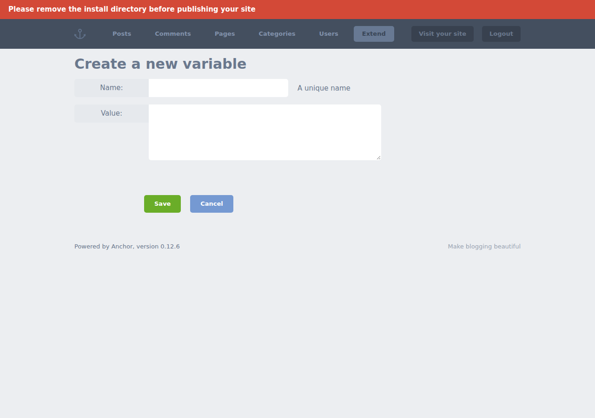
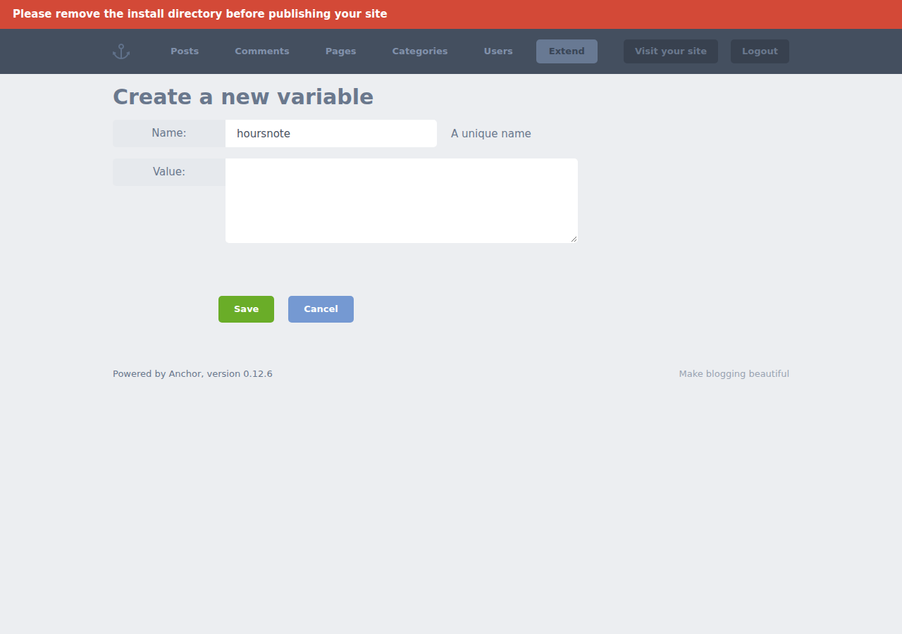
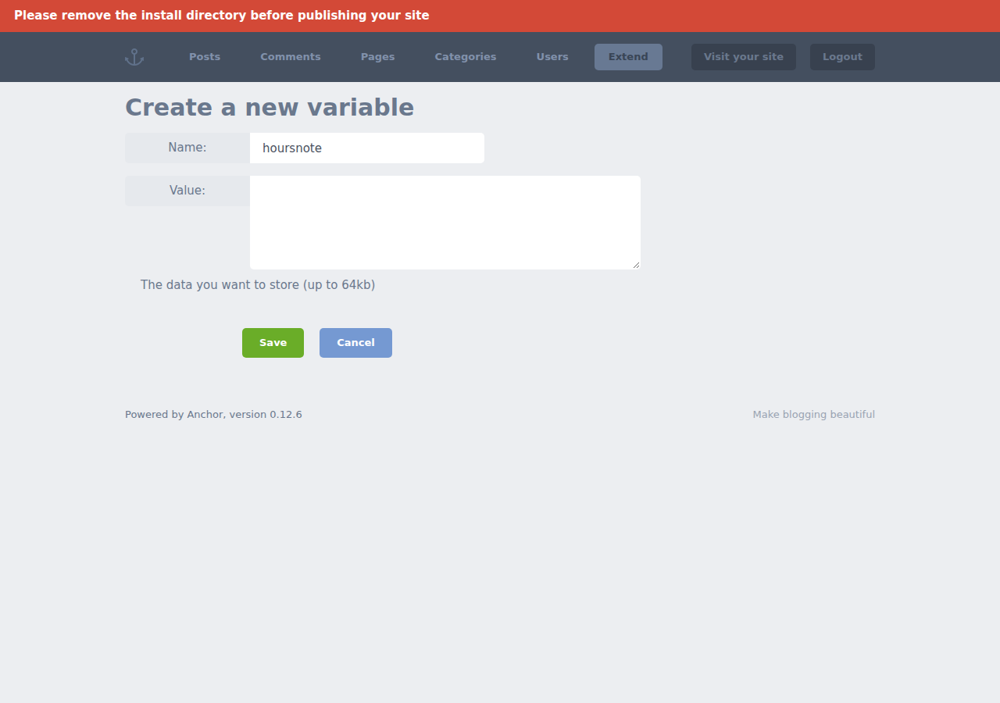
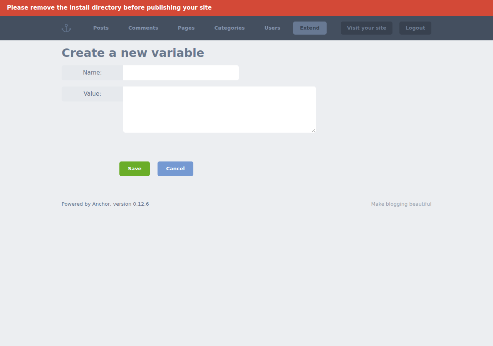

# sweeper-008 · preservation

- 用例：Create a Site Variable named hoursnote with Value exactly Desk hours. Save and inspect the Site Variables list. Report pass if hoursnote is listed with Desk hours, fail if the submitted variable is missing or has a different value, or blocked if you cannot complete the check. Cite the saved list entry.
- 预期：Desk hours
- Agent 判定：blocked
- 独立判定：inconclusive
- Agent 观察：Submission: unknown. Final record observed: false. Final field comparisons: 0 matching, 0 mismatching, 2 unestablished. Verdict: blocked.
- Agent 引用步骤：[0, 3, 6, 7, 8]
- 终止原因：controlled_review
- 独立证据：trigger_not_verified
- 独立读到的值：None
- 动作数：8；模型调用：15
- 耗时：150.90 秒
- 配置哈希：422d96b5120e9b5bb769f7cfc768c550b3b925a6a2082aa91d758d1982cc8a07
- 复跑：`python -m guiqa run --case sweeper-008 --build B --workflow preservation --method qwen-controlled --config /home/fs_2026/qwen3-gui-agent/runs/20261109T032326Z-3c8ffe57/agent-config.json`

## 审查读值

| 字段 | 意图 | 任务要求 | 前态 | 结果 |
|---|---|---|---|---|
| Variable name | generated | hoursnote | {'value': 'hoursnote', 'step': 3} | {'value': '', 'step': 8} |
| Value | generated | Desk hours | {'value': '', 'step': 3} | {'value': '', 'step': 8} |

- 提交：{"status": "unknown", "evidence": null}
- 审查选图：[{"step": 0, "roles": ["before_input_candidate"]}, {"step": 3, "roles": ["input_candidate"]}, {"step": 6, "roles": ["submission_response_candidate"]}, {"step": 7, "roles": ["outcome_candidate"]}, {"step": 8, "roles": ["after_reload"]}]

## 任务状态与记忆

- 状态：finished
- 上下文更新：5 次
- 已压缩至步骤：4
- 检索经验：1 条
- 历史摘要：Steps 1 and 2 are completed: 'hoursnote' entered into the Name field and 'Desk hours' entered into the Value field. Step 3 (Save) is currently in progress. Steps 4 and 5 remain pending as they involve navigating back and verifying the entry. The form is now ready for submission, but the Save action has not been confirmed yet. No errors observed, but persistence must be verified before proceeding to inspection phase. The interface shows no indication of blocking issues at this stage, though final validation requires successful save and subsequent verification of the list entry. The system is in
- 最近反思：The variable creation form is fully filled out correctly according to specifications. However, since the Save button has not yet been clicked, the variable has not been persisted. Without confirming the save, we cannot proceed to the next阶段

- [done] Enter 'hoursnote' into the Name field
- [done] Enter 'Desk hours' into the Value field
- [in_progress] Click the Save button to save the variable
- [pending] Navigate back to the Site Variables list to inspect the saved entry
- [pending] Verify that 'hoursnote' appears with the value 'Desk hours', then report pass/fail/blocked

[任务状态](task-state.json) · [上下文更新](context-events.jsonl) · [工具调用](tool-calls.jsonl) · [本次经验](experience.json)

## 步骤证据

0. Authenticated initial profile

1. click

2. press

3. type

4. click

5. click

6. click

7. press

8. Controller reload before final judgment

