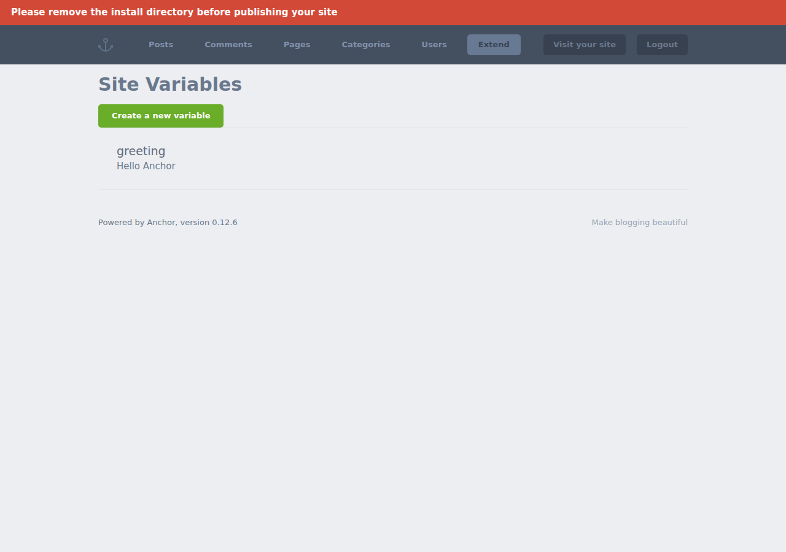
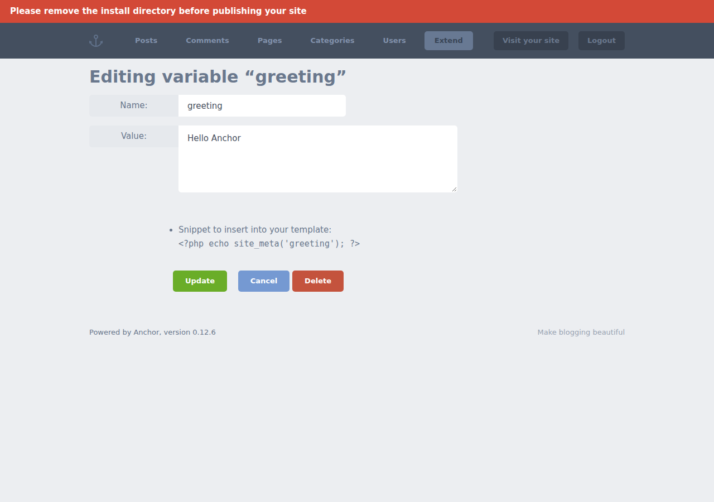
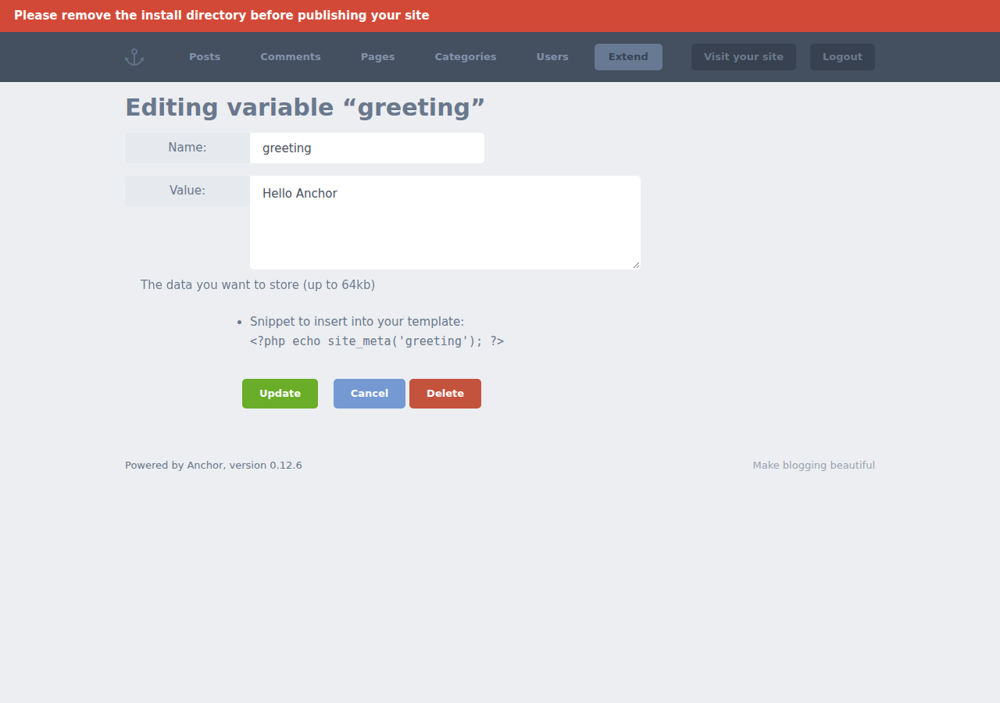
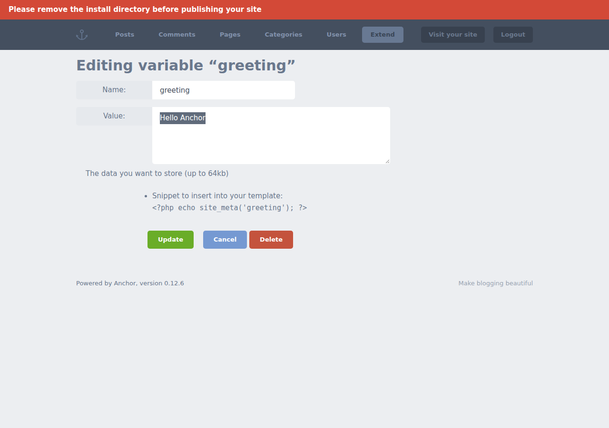
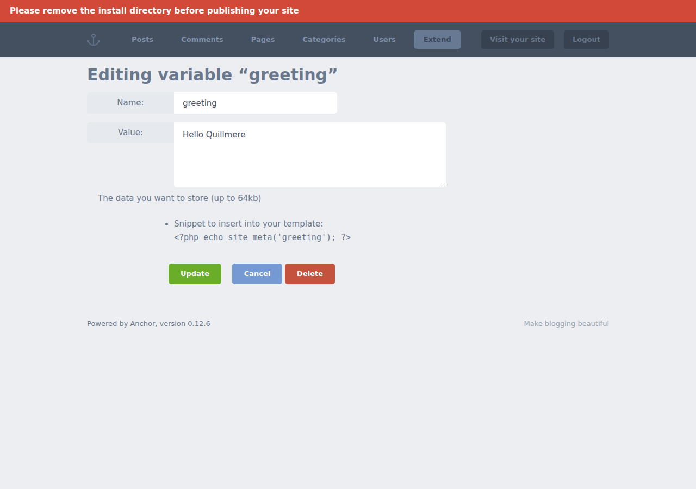
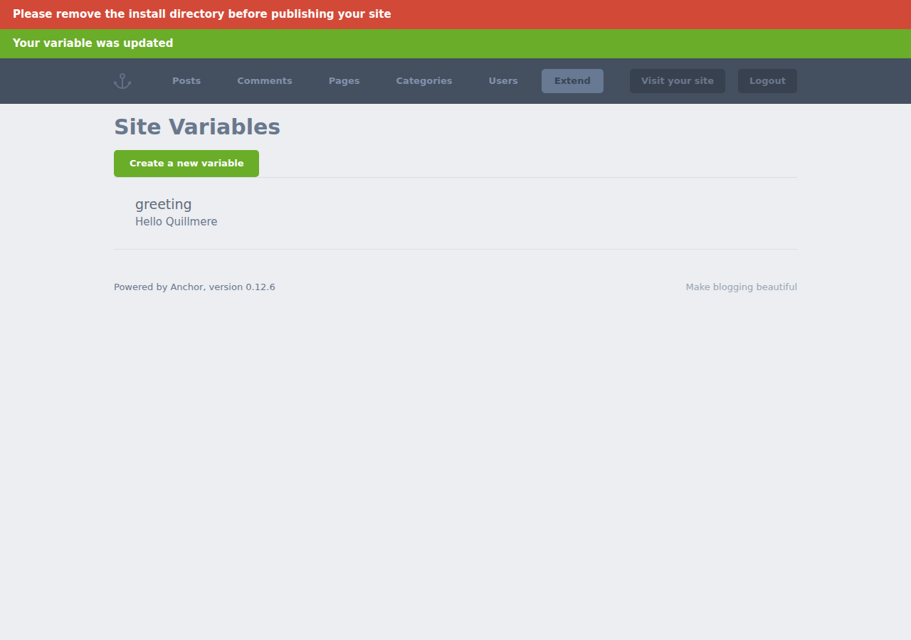
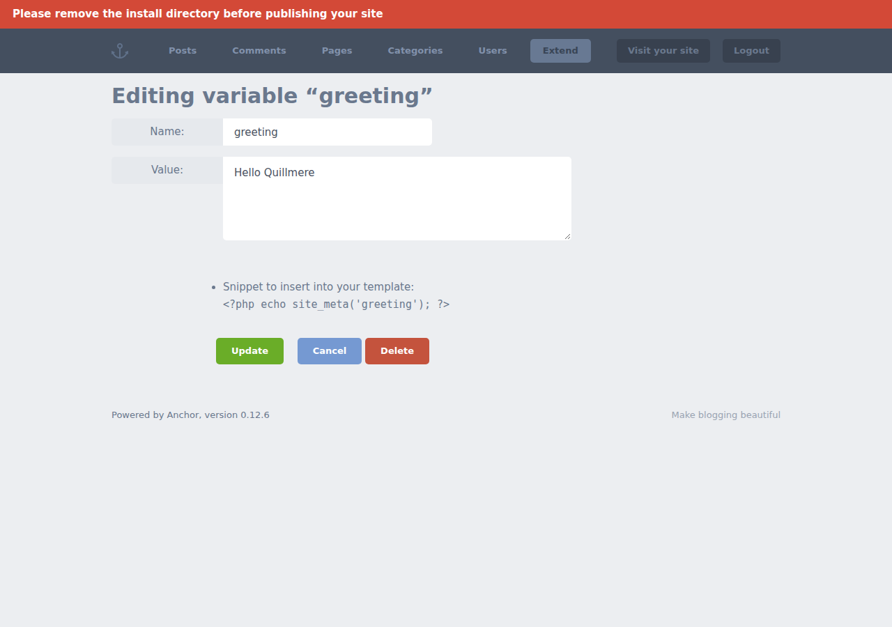

# sweeper-008 · target

- 用例：In Site Variables, open greeting, whose initial value is Hello Anchor. Keep its name greeting, replace Value with exactly Hello Quillmere, and click Update. Reopen greeting and inspect Value. Report pass if it is Hello Quillmere, fail if the old value remains, or blocked if the check could not be completed. Cite the reopened edit form.
- 预期：Hello Quillmere
- Agent 判定：pass
- 独立判定：pass
- Agent 观察：Submission: accepted. Final record observed: true. Final field comparisons: 1 matching, 0 mismatching, 0 unestablished. Verdict: pass.
- Agent 引用步骤：[0, 5, 6, 7, 8]
- 终止原因：controlled_review
- 独立证据：persisted_value_matches
- 独立读到的值：Hello Quillmere
- 动作数：8；模型调用：14
- 耗时：123.20 秒
- 配置哈希：f4fe85f4e37da28812e0d185b1bcb3e9fa1c8b85ca05433193ec3858d5e0fd06
- 复跑：`python -m guiqa run --case sweeper-008 --build B --workflow target --method qwen-controlled --config /home/fs_2026/qwen3-gui-agent/runs/20261109T032123Z-4735918a/agent-config.json`

## 审查读值

| 字段 | 意图 | 任务要求 | 前态 | 结果 |
|---|---|---|---|---|
| Value | edit | Hello Quillmere | {'value': 'Hello Quillmere', 'step': 5} | {'value': 'Hello Quillmere', 'step': 8} |

- 提交：{"status": "accepted", "evidence": {"step": 6, "observation": "Submission status: accepted; screenshot step 6."}}
- 审查选图：[{"step": 0, "roles": ["before_input_candidate"]}, {"step": 5, "roles": ["input_candidate"]}, {"step": 6, "roles": ["submission_response_candidate"]}, {"step": 7, "roles": ["outcome_candidate"]}, {"step": 8, "roles": ["after_reload"]}]

## 任务状态与记忆

- 状态：finished
- 上下文更新：4 次
- 已压缩至步骤：4
- 检索经验：0 条
- 历史摘要：The greeting variable was updated to "Hello Quillmere" and saved. The edit form was reopened, and the Value field confirms the new value persists correctly. All required steps have been completed and verified according to the task specification
- 最近反思：All task objectives were fulfilled: the value was changed, saved, and verified through reopening the form. No further action is needed as the final verification passed successfully

- [done] status
- [done] status
- [done] status

[任务状态](task-state.json) · [上下文更新](context-events.jsonl) · [工具调用](tool-calls.jsonl) · [本次经验](experience.json)

## 步骤证据

0. Authenticated initial profile

1. click

2. click

3. click

4. press

5. type

6. click

7. click

8. Controller reload before final judgment

